# 大肥鱼 Life 源码全景（自动生成）

> 不要直接编辑此页；修改 `diagrams/life-system-current.mmd` / `diagrams/life-candidates-current.mmd` / `diagrams/life-receipt-memory-current.mmd` / `diagrams/life-universal-episodes-current.mmd` 后运行 `npm run write:life-architecture-view`。架构状态及未实现部分见 [源码审计](./life-system-current.md)。

## 一、系统全景

```mermaid
%% 2.8.3-dev.3：模型 / Python / 影音缓存 / Life 记忆均经可信 storageDataPath 解析；离线迁移和回迁均保留原件，Life 回迁只复制当前生效记忆，旧副本隔离且不恢复遗忘。dev.4 补看与深浅记忆自动写入尚未实现。
%% 2.8.3-dev.2：DSH 业务目录仅经独立冷迁移引导切换；LifeMemoryGateway 已增加受控清晰记忆详情附件接口、fuzzy 失效、遗忘保护与备份一致性；真实视频深层写入和自然回忆尚未接入。
%% 2.8.2-dev.50：Life 已核验视频资料后，将同账号执行结果的受控 continuationState 写入现有 Life 事件账本；日记区分已继续行动、自主停止、后续动作未执行与 Episode 完成。旧记录只读保守显示，不补造 BV/画面/模型原因，不增模型调用或新账本。
%% 2.8.2-dev.49：仅视频 Agent 本轮，单次选片读标题/热度/简介；当前账号+轮次真实入选后才提供统一看视频动作，同步尝试画面及字幕/可选 ASR 且各自验收；Life 独立 Episode、评论自由选择与外发门禁不变。
%% 2.8.3-dev.1 模型输入调整：相邻两张12格分镜优先同次本地 Ollama 多图请求，仍逐张校验格号/时间码；只补救失败分镜，不放宽可信视觉回执、预算、权限或记忆边界。
%% 2.8.2 开发增量：本轮视频探索任何阶段均可由模型自主选用已授权视觉工具；现有匿名视频轮次记录仅追加有真实采样与描述的视觉数量统计，不生成单 BV Life 观看回执；Life Episode 菜单持续按当前已核实 BV/步骤预算重新提供观看选项。
%% 2.8.2-dev.46：Life 日记仅在匿名同一 Episode+同一 BV+独立可信视觉回执下合并资料核验与画面观察；时间先后按真实毫秒，不凭近似时间/标题推断；有固定原因码才解释未继续观察。2.8.3 深浅记忆/即时补看仍未实施。
%% Life continuation stop/skip reason is a bounded model category; technical stop codes remain distinct, no raw model rationale persists.
%% 2.8.2 当前增量：视觉模型同调用产出短摘要；Life 自选局部新增证据完成后，复用视频 Agent 模型以无工具文字路由整合有限笔记；无第二记忆库，不改变可衰减记忆与证据校验。
%% 2.8.2-dev.37: FFmpeg focus windows 5-120s use decoded-frame timeline coverage (up to 12 distinct frames per window and remaining Life budget), motion as secondary; owner local redacted stage report in reports/ is NOT Life memory; action tree uses latest executed child and its own receipt.
%% 2.8.2-dev.36: Owner-local focus diagnostic chooses only independently verified preview anchors; separate from Life willingness and memory; existing platform budgets/proof checks unchanged.
%% 2.8.2-dev.28: Life may batch-select 0..N independently verified focus timestamps per decision; dynamic 5-120s windows, three-tier cumulative Episode budgets, initial global candidate pool persists across exploration; every subsequent decoded window still requires original account/host evidence gates. See lib/video-exploration-budget.mjs and lib/life-continuation.mjs.
%% 2.8.2-dev.34：低清分镜 v12 固定每张12格（4×3），逐张核验时间/来源后才交 Life；Whisper 按 BV/模型/语种授权复用本机短期机器转写。来源模型能力与 Headless 逐模型取消同步分属独立配置，不新增权限或语义确认证据。
%% 2.8.2-dev.24: Windows DSH/Python fixed visual prompt parity and verified semantic lines; cross-sheet video-wide fair scan under 1400 tiles; Life post-overview interests/recallable public memory/energy from existing scoped getters; no new permission; 50 MiB nominal focus cap remains distinct from 8 MiB videoshot sprite cap.
%% dev.23: Python budgeted videoshot scan (12/24/48 by owner); vision proposes up to 8 timestamps tied to sampled frames; historically Life chose one (superseded by dev.28 batch choice). No forced four slots, no focus grant; extra media still requires explicit Life proof.
%% dev.22: Life decides first whether to view; owner 12/24/48 controls low-res overview (not speculative pre-watch deep). Vision model suggests only verified sampled timestamps; optional PBP heat is a hint. Focus still needs a second Life proof.
%% dev.21: four verified focus windows include Python neighbor pixel change, matched caption/ASR and clearly unverified vision guesses; skip/defer/error are distinct; no new focus grant.
%% 2.8.2-dev.20: Life voluntary video overview first; Python full videoshot thumbnail candidate scan is bounded, model sees <=48 frames in the selected tier; only AFTER trusted overview Life may separately choose verified-time real-video focus (MP4/DASH + FFmpeg).
%% 2.8.2-dev.18：真实视频低码率取帧仅由官方 PlayURL 当前响应授权；概览疑点只产候选，Life 须独立通过既有意愿门禁再选择局部复查，不能执行器自动补帧。
%% 2.8.2-dev.12: Life 来源 tag 在同一可信 UID 下稳定复用，账号社交名单/外发授权逐 UID 保存；多记忆档案管理仅归档未来，不参与当前运行。
%% 2.8.2-dev.11: Life 历史熟悉感与当前账号互动阶段分开；同一动作的执行回执仅按匿名 actionRef 精确关联，旧日志保守显示。
%% 2.8.2-dev.10: public evidence is same-account/public-event only; poll network backoff handles pre-budget DNS/timeout failures; trace terminal labels share one proof classifier.
%% 2.8.2-dev.8：原 Life 决策步骤只读解释自主选择/技术阻断/平台回执；不写入新账本，不替 Life 行动。
%% 2.8.2-dev.7：Life 完整视觉采样在账号/BV 上跨进程互斥，回执持久化前不放锁；短期账本不覆盖记忆遗忘，长期依据仅当前清晰记忆。
%% 2.8.2-dev.6：原 B站读预算与通知网络退避仅生成按账号状态的只读诊断；无新预算、无重试调度或 Life 决策权。
%% 2.8.2-dev.5：Episode 识图前复用当前账号仍清晰的已核验视觉记忆；采样时间间隔仅表示证据缺口，不代表连续观看。
%% 2.8.2-dev.4：仅当前账号/清晰记忆的精确来源只读追溯；未来浅深分层记忆仍为未实施提案。
%% 2.8.2-dev.3：Episode/视觉证据提供脱敏缺失说明；字幕只标原文字符范围；Reflection 节选禁止独立生成事实；记忆只标未入模数量。
%% 2.8.2-dev.2：选中 BV 仅核实元数据；取帧必须由 Life 续行明确选择 observe_video 和深度，受原账号/视觉/证据门禁约束。
%% Life 事件增量节流、开放式视频回执以及 npm 更新状态为 dev.12 增量，沿原控制/执行安全边界
%% dev.10：可信评论独立沉默/表达、同一社交凭据、视频已选行为排队；源代码在 dev.10 协议与当前架构审计。
%% dev.74：三维关系来自当前账号可信事件；公开评论熟悉度不是主动私信授权。
%% dev.73：普通自主 Life 最短间隔不再由 2 分钟经验/片段续接绕过；真实入站社交独立快唤醒。
%% 管理页只读并列展示线索、契机与待办；Life 已批准不等于平台送达，待回执不能标为中断。
%% 大肥鱼 Life 当前源码全景（2.7.1-dev.72 · Life 授权 FIFO 与事务恢复；继承动态核验与可见 Life 额度）
%% S = 有生产代码接线（非 Windows / B站实机验收）；P = 部分接线；G = 尚无完整闭环
%% 数据行只读与外发分路；不允许把权限/记忆/回执画成万能单系统。
flowchart TB
  %% dev.6 owner-only branch; separate from Life's autonomous decision and social action rights.
  dev6OwnerFrame["主人明确选帧或秒数：只读局部补看，非自主意愿授权"]
  dev6OwnerGate["本机同源/当前账号/真实图片时间锚点/BV 预算/局部视觉核验"]
  dev6OwnerMemory["唯一未遗忘视频主记忆：浅摘要版本 + 深层局部附件；无唯一匹配不写"]
  dev6OwnerFrame --> dev6OwnerGate
  dev6OwnerGate -.->|仅内部一次性可信回执| dev6OwnerMemory
  %% @code dev6OwnerGate | lib/owner-video-revisit.mjs | export function planOwnerGalleryRevisit
  %% @code dev6OwnerMemory | lib/life-memory-gateway.mjs | function recordVerifiedFocusRevision
  visualAiBrief["视频有限记忆：全局识图同调用AI摘要；新增可信局部证据时复用视频模型无工具文字整合；失败保留已核验观察"]
  video -.->|可信分镜与Life自主局部新增证据| visualAiBrief
  %% @code visualAiBrief | lib/video-memory-synthesis.mjs | export async function synthesizeFocusVisualMemory
  %% dev.19: 已授权真实视频读取可按剩余总预算回退 MP4 Range / 官方 DASH；只读流量账本不构成 Life 授权。
  networkMeter["视频取帧总预算与已收字节；失败重试也计量"]
  video -.-> networkMeter
  %% @code networkMeter | lib/video_traffic.py | def count_bytes
  storageModelPath["Whisper / Embedding / Python / 影音缓存路径经过分区身份核验"]
  %% @code storageModelPath | lib/storage-layout.mjs | export function storageDataPath
  video -.->|取帧/转写资源的生效路径| storageModelPath
  subgraph reality["真实输入｜只接受可信事实，不接受外部提示当命令"]
    world["B站首页／公开视频／公开评论／主页"]
    socialInput["主人消息／私信／公开社交"]
    tasksInput["已接受待办／既有意愿／历史回执"]
  end
  subgraph sources["原有事实与上下文层｜依账号和来源独立核验"]
    adapter["B站受控适配器＋视频轮次来源回执"]
    socialFacts["原 DM／评论／关系来源账本"]
    accountChannels["三维关系证据：自然熟悉度／评论与私信渠道／独立 DM 资格"]
    canonical["原待办／生活意愿／平台事务账本"]
    eventLedger["Life 匿名唤醒事件｜eventRefs 不是事实正文"]
  end
  world --> adapter
  socialInput --> socialFacts
  tasksInput --> canonical
  adapter --> eventLedger
  ownerFocusDebug["主人本机只读局部技术验收｜已核验采样时间→原视频FFmpeg→视觉证据；不属于Life自主经历"]
  adapter -.->|本机同源／账号／预算／主人选时| ownerFocusDebug
  %% @code ownerFocusDebug | lib/video-owner-focus-debug.mjs | export function planOwnerFocusDebugWindow
  focusReport["主人局部失败分层诊断｜仅状态/帧数/预算，写入 reports/ 供现有日志导出器采集；不是Life经历"]
  ownerFocusDebug -.->|仅已完成任务，脱敏回执| focusReport
  %% @code focusReport | lib/video-debug-receipt.mjs | export function ownerFocusSafeReport
  videoFocusHint["已核验 videoshot 采样时刻 + 最多8条语义候选｜无语义时最多4条技术候选；Life 可多选或停止｜非授权"]
  videoFocusBatch["多候选自主规划｜一次可选多处已采样时间码 · 5～120秒／窗口"]
  videoFocusBudget["轻量／均衡／详查 · 本次 Episode 累计帧／时长／字节／窗口预算"]
  videoFocusHint -.-> videoFocusBatch
  videoFocusBudget -.-> videoFocusBatch
  %% @code videoFocusBatch | lib/life-continuation.mjs | focusTargets
  %% @code videoFocusBudget | lib/video-exploration-budget.mjs | VIDEO_EXPLORATION_TIERS
  adapter -.->|概览回执可提出候选| videoFocusHint
  videoFocusHint -.->|Life 另行决定；可拒绝/延期| selection
  socialFacts --> accountChannels
  accountChannels -.->|评论熟悉不授权私信| eventLedger
  socialFacts --> eventLedger
  canonical --> eventLedger

  subgraph options["Life 本轮候选｜来源不同、生命周期不同，不能互相替代"]
    todos["todos｜已接受待办中可执行的只读类型"]
    cues["cues｜跨日兴趣／真实评论阅读／本账号已选片的开放式好奇"]
    intentions["intentions｜经核验的跨轮公开探索意愿"]
    opportunities["opportunities｜明确 BV 或公开人物证据的具体机会"]
    friends["friends/social｜已证实的好友机会与匿名入站社交唤醒"]
    video["video｜原视频能力及无兴趣也可选 browse_home"]
    reflection["reflection｜执行器真实就绪状态 canAutoReflect"]
    events["eventRefs｜匿名提示 / 公平重考虑，非操作授权"]
    feedback["本账号真实视频完成反馈｜只读考虑，不受新视频启动冷却影响"]
    ownerChat["talk_to_owner｜可配置联系时间/额度+主 Session 在线；真实经历/闲聊/沉默；可 skip"]
    ownerContactPolicy["主人联系策略｜卡片/自定义窗口和冷却，主 Session 与主人私信共用"]
    networkPollBackoff["B站双通知哨兵与按需详情｜-509/DNS 持久退避"]
  end
  subgraph notificationSentinels["B站消息发现｜两个计数哨兵，不再分别定时拉完整列表"]
    dmSentinel["私信未读计数 single_unread｜正常每 5 分钟"]
    socialSentinel["评论回复/@/点赞计数 msgfeed/unread｜正常每 5 分钟"]
    counterCompare["账号隔离计数快照｜只存分类计数与时间戳"]
    detailsOnChange["按需读取详情｜计数增加/首次基线/30 分钟核对"]
    activeDmSentinel["已确认活跃私信｜60 秒定向读取，空闲逐步放缓"]
  end
  dmSentinel --> counterCompare
  socialSentinel --> counterCompare
  counterCompare -->|私信计数增加| detailsOnChange
  counterCompare -->|互动类别计数增加| detailsOnChange
  counterCompare -.->|30 分钟一致性核对| detailsOnChange
  detailsOnChange --> socialFacts
  detailsOnChange --> adapter
  socialFacts --> activeDmSentinel
  activeDmSentinel --> socialFacts
  sharedReadBudget["原共享 B站只读额度与 -509 冷却｜实际拦截仍由原执行器负责"]
  readAvailability["只读读取状态投影｜共享预算 + DM/互动网络退避；不执行或授予权限"]
  managementReadView["管理中心：分通道延期原因与最早解除；不承诺平台可用"]
  sharedReadBudget -.-> readAvailability
  networkPollBackoff -.-> readAvailability
  readAvailability -.-> managementReadView
  %% @code readAvailability | lib/read-availability-projection.mjs | export function projectReadAvailability
  %% @code sharedReadBudget | lib/bili-read-budget.mjs | export function createBiliReadBudget
  %% @code managementReadView | lib/management-console.js | const readAvailability=scheduler.readAvailability?.lanes
  networkPollBackoff -.-> dmSentinel
  networkPollBackoff -.-> socialSentinel
  networkPollBackoff -.-> detailsOnChange
  networkPollBackoff -.-> activeDmSentinel
  notificationManualCheck["Life check_notifications｜复用哨兵快照，不旁路拉完整列表"]
  notificationManualCheck -.-> counterCompare
  dmAccepted["可信私信/评论邀请 + 原社交模型决定 now/later + 真实待办入账"]
  quickWake["立即 now：同账号有效任务 + 原 Life 运行锁｜直接只读执行，不再次调用意愿模型"]
  socialFacts -.->|同一社交模型的接受和时间选择；校验证据| dmAccepted
  dmAccepted --> canonical
  dmAccepted -.->|仅新建 now 待办，5 分钟内| quickWake
  quickWake -->|同账号、时窗、权限、额度、幂等| readTodo
  canonical --> todos
  canonical --> intentions
  priorVisual["现存可衰减视觉观察｜账号隔离、精确 BV、仍清晰才核对"]
  priorVisual -.->|仅在 Episode 二次视觉采样前只读检查| intentions
  adapter --> cues
  adapter --> opportunities
  historyRelation["旧关系熟悉度｜Life 历史线索，当前账号归属未核实"]
  accountRelationship["当前账号关系投影｜以当前渠道的真实往来为准；对方识别未知"]
  %% @code accountRelationship | lib/account-memory-boundary.mjs | export function currentAccountRelationshipView
  socialFacts -.->|仅历史参考，不用于授权| historyRelation
  historyRelation -.-> accountRelationship
  accountChannels --> accountRelationship --> friends
  eventLedger --> events
  eventLedger --> feedback
  adapter --> video
  canonical --> reflection
  events -.->|仅提示重新查原来源| todos
  events -.->|仅提示重新查原来源| opportunities
  cues --> selection
  intentions --> selection
  opportunities --> selection
  todos --> selection
  friends --> selection
  video --> selection
  reflection --> selection
  events -.-> selection
  feedback -.-> selection
  ownerContactPolicy -.-> ownerChat
  socialRetry["社交实际回复：DM 延期模型错误有界重试 / 评论临时额度不写永久 seen"]
  dynamicVerify["动态来源核验：失败退避重读，旧技术停止可恢复；真身份冲突拒绝"]
  socialFacts --> socialRetry
  socialFacts --> dynamicVerify
  dynamicVerify --> socialRetry
  socialRetry -.->|只有重新核实且具备发送许可才执行| socialWrite
  %% @code dmAccepted | lib/social-todo-intake.mjs | export function intakeAiReadProposals
  %% @code quickWake | lib/autonomous-planner.mjs | const executeAcceptedSocialRead=
  %% @code dynamicVerify | lib/comment-interact.mjs | export const dynamicVerificationRetryDelay
  networkPollBackoff -.-> socialFacts
  ownerChat -.-> selection

  subgraph decision["唯一 Life 自主决策中心｜不给模型任意 UID / BV / 写权限"]
    selection["候选筛选 + 去重归属 + 账号/冷却/额度检查"]
    willingnessQueue["Life 账号内有界 FIFO 等待：同窗口择一，跨窗口等待证明结算；未知外发仍停机复核"]
    planner["AutonomousPlanner + Life Voice + 当轮动作菜单"]
    universalEpisode["Universal Episode｜账号匿名因果片段：有真实回执才计入已完成动作"]
    resumeEpisode["resume_episode｜暂停到期可复续；优先旧片段，来源与权限每步重新核验"]
    menuGuard["后端再次核对：action/id/BV/capability 必须确在本轮菜单"]
    rest["skip：鱼鱼自由休息；技术失败不得伪装休息"]
  end
  selection --> willingnessQueue --> planner --> menuGuard
  universalEpisode -.->|只提供历史/关联，不授予权限| planner
  menuGuard --> resumeEpisode -.-> lifeEpisode
  menuGuard --> rest
  ownerBridge["主 Session Bridge｜选中后 followup 到已绑定主 Session"]
  ownerQueue["宿主接收排队或未知｜非实际聊天送达，不计已完成平台回执"]
  menuGuard --> ownerBridge --> ownerQueue

  subgraph readlane["受控读取｜真实读取不等于完整观看"]
    readTodo["原只读待办"]
    explore["公开搜索/视频元数据/作者作品/已证实人物"]
    home["browse_home → 原视频 Agent → 首页候选/选片归因；无每日入选数限额"]
    roundFunnel["本轮视频工具回执漏斗：候选/详情/内容证据/入选/失败；不等于完整观看"]
    lifeEpisode["Life Episode · 账号绑定意愿账本 · 最多 5 个已核验步骤"]
    homeCandidateMatch["首页候选 BV 与本轮新入选 BV 精确匹配；原始 BV 只瞬时返回宿主"]
    homeEpisode["仅成功的 Life 首页轮次回执后建立 home-browse intention"]
    inspectedSource["Life inspect_opportunity 同 BV 核实成功／execute_read 可信 watch_video 完成"]
    episodeContinuation["Life 自选续行：先 observe_video standard 全局缩略图或休息；实际观察后才可能 focus_video · 最多 4 次"]
    episodeVisualFirst["Life 已选择首次全局：Python 资源受限扫描 videoshot · 主人档位最多12/24/48帧分镜"]
    episodeVisualModel["视觉模型首次概览：最多8条真实采样时间的语义待核实建议；不声称完整观看"]
    episodeLifeSecond["Life 看后结合人格/情绪/记忆与候选线索自主选择：深入/跳过/延期；错误不等于拒绝"]
    episodeFocusRead["真实 MP4/DASH Range + FFmpeg 局部取帧 · 视觉模型第二次（仅获授权）"]
    episodeDiscussion["独立只读当前已核实 BV 的公开评论区；不强迫回复"]
    episodeHomeMore["可自愿额外获取一次首页推荐；候选未必入选"]
    episodeAftercare["已核验写入计一步 · 下一写前必须真只读或实际休息；每 tick 最多一写"]
  end
  menuGuard --> readTodo
  menuGuard --> explore
  menuGuard --> home
  readTodo --> receipts
  explore --> receipts
  home --> receipts
  home -.->|仅真实工具返回状态| roundFunnel
  roundFunnel -.->|汇总到原 Life 视频轮次/日报；不授予写权限| decisions
  home --> homeCandidateMatch -->|仅本轮精确匹配入选 BV；不等于观看| homeEpisode
  homeEpisode --> lifeEpisode
  explore -.->|搜索/人物作品/视频核验成功后进入同一意愿账本| lifeEpisode
  lifeEpisode --> episodeContinuation -->|明确选定取帧及深度| episodeVisualFirst
  episodeVisualFirst --> episodeVisualModel --> episodeLifeSecond
  episodeLifeSecond -->|明确选择，时间锚点校验| episodeFocusRead
  episodeLifeSecond -->|拒绝/延期| rest
  episodeFocusRead --> visualLease
  visualLease["账号/BV跨进程视觉只读锁｜持有至核验回执写入；不授权读写"]
  %% @code visualLease | lib/life-planner-atomic.mjs | export async function withLifeVideoVisualLease
  lifeEpisode --> episodeDiscussion --> episodeContinuation
  lifeEpisode --> episodeHomeMore --> episodeContinuation
  lifeEpisode --> episodeAftercare -.->|只读／休息后再次选择，非自动外发| episodeContinuation
  lifeEpisode --> episodeContinuation -.->|下一步重新选择；到上限/休息/结束时停止| selection

  %% @code episodeVisualFirst | lib/autonomous-planner.mjs | const observeSelectedVideo=async
  %% @code commentReview | vendor/bilibili-mcp/mcp_server.py | async def bili_comment_consideration
  %% @code commentDiagnosis | lib/video-comment-readiness.mjs | classifyVideoCommentRound
%% @code commentAdmission | lib/life-video-action-bridge.mjs | reviewApprovals.set(key,
  %% @code commentAdmission | lib/life-video-action-bridge.mjs | reviewApprovals.set(key,
  subgraph outgoing["Life 意愿驱动写入｜无法绕开各渠道技术权限"]
    videoWrite["Life 独立意愿 → 原技术写入桥 → Python MCP 工具"]
    commentReview["Video Agent 提供入选 BV、候选草稿及依据；Life 决定 want/pass/defer 和最终正文"]
    commentDiagnosis["轮次结束时枚举诊断：没考虑／想说未提议／自愿否决／技术阻断／回执未知"]
    commentAdmission["唯一 Life 意愿 proof：账号／轮次／BV／最终正文绑定，一次消费；不二次考虑"]
    socialWrite["私信/评论/分享 → 关系与渠道授权 → 原社交发送事务"]
  end
  menuGuard -.->|仅合规候选/委派；不直接写平台| videoWrite
  home -.->|已选片后可自主考虑；不强制发言| commentReview
  commentReview -.->|Life 独立决定的唯一表达意愿| commentAdmission
  commentAdmission -.-> videoWrite
  commentReview -.-> commentDiagnosis
  videoWrite -.-> commentDiagnosis
  menuGuard -.->|仅好友/社交许可；不直接发送| socialWrite
  videoWrite --> receipts
  socialWrite --> receipts

  subgraph journal["结果核验｜不把失败/未知记成成功"]
    receipts["原工具回执/平台独立核实 + unknown 冻结"]
    decisions["Life 脱敏决策轨迹/匿名事件结算（非事实源）"]
    verifiedActions["成功且身份匹配的实际行动投影"]
  end
  menuGuard --> decisions
  receipts --> decisions
  receipts -->|仅经验证成功| verifiedActions
  decisionExplanation["只读意愿解释：选择/技术阻断/回执等级｜非新事实源"]
  managementExplanation["管理中心决策链与行动树：未结算不冒充完成"]
  decisions -.-> decisionExplanation -.-> managementExplanation
  %% @code decisionExplanation | lib/life-decision-trace.mjs | export function lifeTraceExplanation
  %% @code managementExplanation | lib/management-console.js | const explanations={

  subgraph memory["统一回忆与成长｜精确事实仍回原受权账本核实"]
    gateway["Life Memory / 协调器：可衰减情节、隐私和遗忘"]
    retriever["Recall：时间/意图/账户权限硬过滤 → 词法/可选本地向量排序"]
    growth["兴趣、情绪、关系与反思：影响下一轮候选，不授予权限"]
  end
  verifiedActions --> gateway
  verifiedActions --> universalEpisode
  lifeEpisode --> universalEpisode
  gateway --> retriever
  gateway --> growth
  retriever -.->|仅当前可召回证据| planner
  growth -.->|仅已核实新线索| cues
  growth -.->|仅已有来源的新机会| opportunities
  decisions -.->|提示下一轮，不证明写入成功| eventLedger

  %% @code roundFunnel | lib/video-round-funnel.mjs | export function summarizeVideoFunnel

  subgraph gaps["当前仍未形成完整生产闭环 / 实机验收"]
    gapSocial["跨串陌生人回复/任意评论者主页：未通用开放"]
    gapRecall["所有历史/legacy full Agent 统一按需回忆：尚不完整"]
    gapGrowth["长期兴趣/人格因果、真实 Windows/平台/本地 GGUF/72h：未验收"]
  end
  gapSocial ~~~ gapRecall ~~~ gapGrowth
  dev54Scheduler["Life 定时器 ensureStarted：恢复检查心跳，不越过权限／回执门禁"]
  dev4AutoRecovery["dev.4 规划运行锁：证明旧 PID 已退出 → 原子回收；异常拒绝，不重播旧动作"]
  dev4AutoRecovery -.-> dev54Scheduler
  %% @code dev4AutoRecovery | lib/life-planner-atomic.mjs | function reclaimDeadPlannerRun
  dev54Diary["Owner 日记：已核验 BV/UID 跳转，未知目标不推断"]
  dev54Recall["神经回忆：trace 不命中、结果相关性排序"]
  %% @code dev54Scheduler | lib/autonomous-planner.mjs | const ensureStarted=()=>
  %% @code dev54Diary | lib/life-timeline.mjs | export function buildLifeTimeline
  %% @code dev54Recall | lib/memory-neural-projection.mjs | const keywordRelevance=
  classDef active fill:#e8f3ff,stroke:#3579c9,color:#17385f
  classDef partial fill:#fff7e4,stroke:#d99727,color:#6b4717
  classDef gap fill:#fff0f1,stroke:#d26975,color:#822f39
  class planner,menuGuard,selection,readTodo,explore,home,lifeEpisode,homeEpisode,homeCandidateMatch,episodeContinuation,episodeDiscussion,episodeHomeMore,episodeAftercare,verifiedActions,receipts,eventLedger active
  class friends,socialWrite,videoWrite,gateway,retriever,growth,dmSentinel,socialSentinel,counterCompare,detailsOnChange,activeDmSentinel,notificationManualCheck partial
  class gapSocial,gapRecall,gapGrowth gap

%% @code adapter | lib/life-home-feed-evidence.mjs | export function summarizeHomeFeedResult
%% @code eventLedger | lib/life-agent-events.mjs | export function createLifeAgentEvents
%% @code todos | lib/owner-todos.mjs | export const READ_TODO_TYPES
%% @code cues | lib/life-opportunities.mjs | const explorationCues=
%% @code intentions | lib/life-opportunities.mjs | const intentions=
%% @code opportunities | lib/life-opportunities.mjs | export function createLifeOpportunities
%% @code friends | lib/life-friend-initiatives.mjs | export function createLifeFriendInitiatives
%% @code video | lib/autonomous-planner.mjs | if(homeEnabled&&lifeSkills.some
%% @code reflection | lib/life-reflection.mjs | export function createLifeReflection
%% @code events | lib/life-agent-events.mjs | const TYPES=new Set
%% @code selection | lib/autonomous-planner.mjs | reconcileAutonomousActions
%% @code planner | lib/autonomous-planner.mjs | export function plannerActionMenu
%% @code menuGuard | lib/autonomous-planner.mjs | export function validateOfferedLifeAction
%% @code home | lib/life-agent-events.mjs | homePickedCount
%% @code lifeEpisode | lib/life-opportunities.mjs | const beginHomeExploration=
%% @code episodeContinuation | lib/autonomous-planner.mjs | const continueLifeRead=async (intentionId)
%% @code homeEpisode | index.js | const episode=lifeOpportunities.beginHomeExploration
%% @code homeCandidateMatch | lib/life-agent-events.mjs | let transientHomePickedBvids=null
%% @code videoWrite | lib/life-continuation-write.mjs | export function createLifeContinuationWriteExecutor
%% @code socialWrite | index.js | runFriendInitiative:
%% @code receipts | lib/life-video-action-bridge.mjs | export function createLifeVideoActionBridge
%% @code decisions | lib/life-decision-trace.mjs | export function createLifeDecisionTrace
%% @code verifiedActions | lib/life-action-memory.mjs | export function verifiedLifeActionEvent
%% @code gateway | lib/life-memory-coordinator.mjs | export function createLifeMemoryCoordinator
%% @code retriever | lib/memory-retriever.mjs | export function createMemoryRetriever
%% @code growth | lib/life-interests.mjs | export function recordInterestEvents

%% @code episodeDiscussion | lib/life-opportunities.mjs | const inspectVideoDiscussion=
%% @code episodeHomeMore | lib/life-opportunities.mjs | const browseHomeMore=
%% @code episodeAftercare | lib/life-opportunities.mjs | entry.writeAftercare='read-or-rest'

%% @code universalEpisode | lib/life-universal-episodes.mjs | export function createUniversalLifeEpisodes
%% @code resumeEpisode | lib/autonomous-planner.mjs | action:'resume_episode'

%% @code resumeEpisode | lib/life-universal-episodes.mjs | const due=
%% @code commentReview | vendor/bilibili-mcp/mcp_server.py | async def bili_ledger_mark

%% @code feedback | lib/autonomous-planner.mjs | const videoFeedbackPending=

%% dev.38：专业 Agent 局部自主性——模型可以自主提议，但原职责/权限分开。
subgraph subagentLoop["dev.38 专业 Agent 续行｜第一阶段，非全 Agent 通用循环"]
  subagentContext["Subagent Handoff｜同账号、同来源、脱敏 Episode 摘要"]
  dmChoice["私信 Agent｜完整回复草稿→自然气泡分段；可选关注/取关联系人"]
  dmPending["原私信状态 pendingLifeAction｜75s 后跨 poll 重新审批"]
  dmFollow["已核验真实来信 UID｜单次意愿凭据 + 关注/取关原平台回执；取关须本插件关注满七天"]
end
universalEpisode -.->|不授予权限| subagentContext
subagentContext -.-> dmChoice
socialFacts -.->|实名 UID 仅由原私信来源核验| dmChoice
dmChoice -.->|私信已送达才保留可选意愿| dmPending
dmPending -.->|重新核验、可以拒绝| dmFollow
dmFollow -->|已核实后回执| receipts
%% @code subagentContext | lib/life-subagent-continuity.mjs | export function lifeSubagentHandoff
%% @code dmChoice | lib/interaction-batch.mjs | availableLifeActions
%% @code dmPending | lib/dm-autoreply.mjs | person.pendingLifeAction=
%% @code dmFollow | vendor/bilibili-mcp/mcp_server.py | async def bili_follow_dm_contact

%% dev.42: owner opt-in and verified lifecycle; not a platform delivery receipt.
%% @code ownerChat | lib/autonomous-planner.mjs | action:'talk_to_owner'
%% @code ownerBridge | lib/main-session-bridge.mjs | const initiateOwnerChat=

%% dev.44: opt-in owner policy and rate-limit recovery.
%% @code ownerContactPolicy | lib/owner-contact-policy.mjs | export function ownerContactPolicy
%% @code dmSentinel | lib/dm.mjs | export async function readPrivateUnreadCounts
%% @code socialSentinel | lib/dm.mjs | export async function readInteractionUnreadCounts
%% @code counterCompare | lib/notification-sentinel-state.mjs | export function createNotificationSentinelState
%% @code detailsOnChange | lib/interaction-scheduler.mjs | const categories=sentinelState.pendingSocialCategories
%% @code activeDmSentinel | lib/dm-autoreply.mjs | hasDueContinuation:()=>lifeInbox.due(1).length>0
%% @code notificationManualCheck | index.js | const result=await interactionScheduler.checkNow()
%% @code networkPollBackoff | lib/network-poll-backoff.mjs | export function createNetworkPollBackoff

%% dev.59: DM/Comment keeps one model call with Life Voice, then seals exact expression without AI.
lifeOwnsSpeech["交互批处理中的 Life Voice｜单次模型选择回复/沉默/延期及最终表达"]
professionalDraft["DM / Comment 专业感知｜读取真实事件和场景上下文，不替 Life 决定沉默"]
socialProofSeal["LifeWillingness｜绑定账号/收件人/线程/正文；未消费过期可释放，已消费/旧未知需离线复核"]
lifeProofExpiry["过期未消费 proof｜先 settle(not-sent)，再清理内存记录"]
lifeAdmissionUsed["持久 used 标记｜最终执行校验前写入"]
lifeProofSettlement["发送路径结算｜提前退出 not-sent，异常 uncertain，平台回执 verified"]
shadowRetired["历史 social-shadow 样本｜active 模式不再调用第二模型；只读留痕"]
journeyGroups["鱼的记忆｜以同轮 video-round / Episode 精确回执分组，独立事件不硬连"]
professionalDraft --> lifeOwnsSpeech --> socialProofSeal --> lifeAdmissionUsed --> socialWrite
lifeProofExpiry -.->|只释放明确未消费的过期许可| socialProofSeal
socialWrite --> lifeProofSettlement --> receipts
shadowRetired -.->|不参与发送| journeyGroups
receipts -->|只有来源可证实时关联| journeyGroups
%% @code lifeOwnsSpeech | lib/interaction-batch.mjs | 你是大肥鱼的 Life 意愿与表达主体
%% @code professionalDraft | index.js | const generated=await interactionBatcher.generate({kind:'dm'
%% @code socialProofSeal | lib/life-willingness.mjs | function adoptSocialDecision
%% @code lifeProofExpiry | lib/life-willingness.mjs | const forgetOld=()=>
%% @code lifeAdmissionUsed | lib/life-willingness-admission.mjs | function markUsed(scope,token)
%% @code lifeProofSettlement | index.js | const lifeProofSettler=proof=>
%% @code shadowRetired | lib/autonomous-planner.mjs | outcome.result='social-signal-considered'
%% @code journeyGroups | lib/life-timeline.mjs | export function groupLifeTimeline

%% dev.57: local model failure evidence is neither Life intention nor permission.
modelFailureLedger["Life 模型退避账本｜失败分类/次数/下一次允许尝试"]
modelHealthUi["管理中心｜安全错误证据、请求 ID、恢复时间"]
modelBackoffClear["主人确认解除｜只清理 Life 模型失败计时"]
planner -->|模型调用失败才记录| modelFailureLedger
modelFailureLedger -.->|只读投影| modelHealthUi
modelHealthUi -.->|主人确认，状态匹配| modelBackoffClear
modelBackoffClear -.->|不调用模型/不增加发送权限| modelFailureLedger
%% @code modelFailureLedger | lib/autonomous-planner.mjs | s.modelFailureEvidence={
%% @code modelHealthUi | lib/system-health-projection.mjs | title:'Life 模型失败 · 正在自动退避'
%% @code modelBackoffClear | lib/autonomous-planner.mjs | const clearModelBackoff=

%% dev.59: local Host-only model attribution, no additional AI call.
modelJournal["宿主模型调用归因｜账号隔离/耗时/错误分类，Headless 内部调用不包含"]
modelHealthUi -.->|只读本地调用记录| modelJournal
%% @code modelJournal | lib/model-invocation-journal.mjs | export function createModelInvocationJournal

%% @code accountChannels | lib/social-relationship-channels.mjs | export function createSocialRelationshipChannels

  inspectedSource -->|原机会/待办账本与视频读取证明| lifeEpisode
%% @code inspectedSource | lib/autonomous-planner.mjs | const next=beginInspectedOpportunity

%% dev.12: the original planner keeps global agency while evidence novelty limits redundant local loops.
localNovelty["dev.12 新增公开证据才主动唤醒额外局部推理
无新增时保留未来独立选择"]
planner -.->|仅节省重复调用，不代替模型决定喜恶| localNovelty
%% @code localNovelty | lib/autonomous-planner.mjs | no-new-public-evidence
%% 2.8.2 PR-1A: bounded *prompt-only* context delivery; never a permission,
%% receipt, memory fact or autonomous decision. The original Life route stays.
contextDelivery282["模型实收上下文｜Episode/字幕/反思/记忆标记覆盖与缺失；只读、不存原文"]
contextDelivery282 -.->|仅向当前 Life 模型说明缺失，非授权| planner
%% @code contextDelivery282 | lib/context-delivery.mjs | export function deliverJsonContext

%% dev.6: explicit main-session progressive recall; voluntary revisit keeps Life agency.
  focusRecall283["主 Session 按需展开当前清晰 BV 深层片段；不联网"]
  focusRecall283 -.->|不增加后台机会或外发权限| planner
%% @code focusRecall283 | lib/life-memory-gateway.mjs | function recallVideoDetails
```

## 二、八类候选细目

```mermaid
%% 2.8.3-dev.3：模型 / Python / 影音缓存 / Life 记忆均经可信 storageDataPath 解析；离线迁移和回迁均保留原件，Life 回迁只复制当前生效记忆，旧副本隔离且不恢复遗忘。dev.4 补看与深浅记忆自动写入尚未实现。
%% 2.8.3-dev.2：DSH 业务目录仅经独立冷迁移引导切换；LifeMemoryGateway 已增加受控清晰记忆详情附件接口、fuzzy 失效、遗忘保护与备份一致性；真实视频深层写入和自然回忆尚未接入。
%% 2.8.2-dev.50：Life 已核验视频资料后，将同账号执行结果的受控 continuationState 写入现有 Life 事件账本；日记区分已继续行动、自主停止、后续动作未执行与 Episode 完成。旧记录只读保守显示，不补造 BV/画面/模型原因，不增模型调用或新账本。
%% 2.8.2-dev.49：仅视频 Agent 本轮，单次选片读标题/热度/简介；当前账号+轮次真实入选后才提供统一看视频动作，同步尝试画面及字幕/可选 ASR 且各自验收；Life 独立 Episode、评论自由选择与外发门禁不变。
%% 2.8.3-dev.1 模型输入调整：相邻两张12格分镜优先同次本地 Ollama 多图请求，仍逐张校验格号/时间码；只补救失败分镜，不放宽可信视觉回执、预算、权限或记忆边界。
%% 2.8.2 开发增量：本轮视频探索任何阶段均可由模型自主选用已授权视觉工具；现有匿名视频轮次记录仅追加有真实采样与描述的视觉数量统计，不生成单 BV Life 观看回执；Life Episode 菜单持续按当前已核实 BV/步骤预算重新提供观看选项。
%% 2.8.2-dev.46：Life 日记仅在匿名同一 Episode+同一 BV+独立可信视觉回执下合并资料核验与画面观察；时间先后按真实毫秒，不凭近似时间/标题推断；有固定原因码才解释未继续观察。2.8.3 深浅记忆/即时补看仍未实施。
%% Life continuation stop/skip reason is a bounded model category; technical stop codes remain distinct, no raw model rationale persists.
%% 2.8.2 当前增量：视觉模型同调用产出短摘要；Life 自选局部新增证据完成后，复用视频 Agent 模型以无工具文字路由整合有限笔记；无第二记忆库，不改变可衰减记忆与证据校验。
%% 2.8.2-dev.37: FFmpeg focus windows 5-120s use decoded-frame timeline coverage (up to 12 distinct frames per window and remaining Life budget), motion as secondary; owner local redacted stage report in reports/ is NOT Life memory; action tree uses latest executed child and its own receipt.
%% 2.8.2-dev.36: Owner-local focus diagnostic chooses only independently verified preview anchors; separate from Life willingness and memory; existing platform budgets/proof checks unchanged.
%% 2.8.2-dev.28: Life may batch-select 0..N independently verified focus timestamps per decision; dynamic 5-120s windows, three-tier cumulative Episode budgets, initial global candidate pool persists across exploration; every subsequent decoded window still requires original account/host evidence gates. See lib/video-exploration-budget.mjs and lib/life-continuation.mjs.
%% 2.8.2-dev.34：低清分镜 v12 固定每张12格（4×3），逐张核验时间/来源后才交 Life；Whisper 按 BV/模型/语种授权复用本机短期机器转写。来源模型能力与 Headless 逐模型取消同步分属独立配置，不新增权限或语义确认证据。
%% 2.8.2-dev.24: Windows DSH/Python fixed visual prompt parity and verified semantic lines; cross-sheet video-wide fair scan under 1400 tiles; Life post-overview interests/recallable public memory/energy from existing scoped getters; no new permission; 50 MiB nominal focus cap remains distinct from 8 MiB videoshot sprite cap.
%% dev.23: Python budgeted videoshot scan (12/24/48 by owner); vision proposes up to 8 timestamps tied to sampled frames; historically Life chose one (superseded by dev.28 batch choice). No forced four slots, no focus grant; extra media still requires explicit Life proof.
%% dev.22: Life decides first whether to view; owner 12/24/48 controls low-res overview (not speculative pre-watch deep). Vision model suggests only verified sampled timestamps; optional PBP heat is a hint. Focus still needs a second Life proof.
%% dev.21: four verified focus windows include Python neighbor pixel change, matched caption/ASR and clearly unverified vision guesses; skip/defer/error are distinct; no new focus grant.
%% 2.8.2-dev.20: Life voluntary video overview first; Python full videoshot thumbnail candidate scan is bounded, model sees <=48 frames in the selected tier; only AFTER trusted overview Life may separately choose verified-time real-video focus (MP4/DASH + FFmpeg).
%% 2.8.2-dev.18：真实视频低码率取帧仅由官方 PlayURL 当前响应授权；概览疑点只产候选，Life 须独立通过既有意愿门禁再选择局部复查，不能执行器自动补帧。
%% 2.8.2-dev.12: Life 来源 tag 在同一可信 UID 下稳定复用，账号社交名单/外发授权逐 UID 保存；多记忆档案管理仅归档未来，不参与当前运行。
%% 2.8.2-dev.11: Life 历史熟悉感与当前账号互动阶段分开；同一动作的执行回执仅按匿名 actionRef 精确关联，旧日志保守显示。
%% 2.8.2-dev.10: public evidence is same-account/public-event only; poll network backoff handles pre-budget DNS/timeout failures; trace terminal labels share one proof classifier.
%% 2.8.2-dev.8：原 Life 决策步骤只读解释自主选择/技术阻断/平台回执；不写入新账本，不替 Life 行动。
%% 2.8.2-dev.7：Life 完整视觉采样在账号/BV 上跨进程互斥，回执持久化前不放锁；短期账本不覆盖记忆遗忘，长期依据仅当前清晰记忆。
%% 2.8.2-dev.6：原 B站读预算与通知网络退避仅生成按账号状态的只读诊断；无新预算、无重试调度或 Life 决策权。
%% 2.8.2-dev.5：Episode 识图前复用当前账号仍清晰的已核验视觉记忆；采样时间间隔仅表示证据缺口，不代表连续观看。
%% 2.8.2-dev.4：仅当前账号/清晰记忆的精确来源只读追溯；未来浅深分层记忆仍为未实施提案。
%% 2.8.2-dev.3：Episode/视觉证据提供脱敏缺失说明；字幕只标原文字符范围；Reflection 节选禁止独立生成事实；记忆只标未入模数量。
%% 2.8.2-dev.2：选中 BV 仅核实元数据；取帧必须由 Life 续行明确选择 observe_video 和深度，受原账号/视觉/证据门禁约束。
%% dev.12：具跨日公共关系证据的评论者作品为可选只读行动，不是自由 UID 或私信权限
%% dev.10：同窗口选择携带经清洗的候选公开视频证据；混合私信不带出正文。
%% dev.74：关系按自然熟悉度/渠道证据/DM Openness 三维分离，只有私人关系才可能授权发起。
%% dev.73：普通自主 Life 最短间隔不再由 2 分钟经验/片段续接绕过；真实入站社交独立快唤醒。
%% 管理页只读并列展示线索、契机与待办；Life 已批准不等于平台送达，待回执不能标为中断。
%% dev.71：继承 dev.70 动态核验恢复与可见 Life 额度；Life 授权证明消费/结算按 dev.71 账本契约执行。
%% 生活候选细目字典：这是当前项目的真实 schema 类型/选择约束，不是泛化的 AI 心理推演。
flowchart LR
  %% dev.6: owner-selected limited video focus; not autonomous Life or platform write.
  dev6OwnerFrame["主人选定真实帧或秒数：只读有限补看"]
  dev6OwnerGate["同源、账号、BV、时间锚点、视觉核验"]
  dev6OwnerMemory["唯一未遗忘视频主记忆：浅摘要版本与深层新增片段"]
  dev6OwnerFrame --> dev6OwnerGate
  dev6OwnerGate -.->|一次性可信回执；无唯一记忆则不写| dev6OwnerMemory
  %% @code dev6OwnerGate | lib/owner-video-revisit.mjs | export function planOwnerGalleryRevisit
  %% @code dev6OwnerMemory | lib/life-memory-gateway.mjs | function recordVerifiedFocusRevision

  visualAiBrief["视频有限记忆：全局识图同调用AI摘要；新增可信局部证据时复用视频模型无工具文字整合；失败保留已核验观察"]
  video -.->|自愿选择后才执行| visualAiBrief
  %% @code visualAiBrief | lib/video-memory-synthesis.mjs | export async function synthesizeFocusVisualMemory
  %% dev.19: 已授权真实视频读取可按剩余总预算回退 MP4 Range / 官方 DASH；只读流量账本不构成 Life 授权。
  videoRecovery["明确观看后先完整 DURL，失败按预算重试 MP4 / DASH"]
  video -.-> videoRecovery
  %% @code videoRecovery | lib/adaptive_video.py | def _acquire_adaptive_frames_impl
  storageOptions["Life 候选不因数据分盘获得新权限；只改变资源的可信路径"]
  %% @code storageOptions | lib/storage-layout.mjs | export function storageDataPath
  video -.-> storageOptions
  subgraph inputs["有事实来源，才能构成候选"]
    sourceTodo["原 accepted TODO：open/deferred 且到期"]
    sourceInterest["LifeInterests：账号绑定、跨日自主选片兴趣及有时效的开放式好奇"]
    sourceDiscussion["已有 BV 评论阅读 + 可核验主观疑问"]
    sourcePerson["SocialPortrait：跨日公开双向交流证据"]
    sourceLife["LifeOpportunities 意愿账本：ready/inspected、未过期"]
    episodeState["Universal Episode｜已核验步骤 + 到期暂停恢复；不可代替原目标凭据"]
    sourceSocial["匿名 dm-received/comment-received 事件"]
    privateBound["当前账号渠道事实 + DM 开放资格｜评论熟悉不能转私信"]
    sourceVideo["video-explore 可用 + 首页来源开关 + 启动冷却"]
    sourceVideoFeedback["已核验视频子进程结束回执｜只读，与下次启动冷却独立"]
    sourceReflect["LifeReflection.status().canAutoReflect"]
    sourceOwner["主人联系卡片/自定义额度 + 明确绑定且在线的主 Session + 可选沉默续聊"]
  end
  subgraph candidates["本轮实际类型 / 内容边界"]
    todos["todos：已接待办｜新任务由 Life 自主安排，已确定动作只做技术复核"]
    cues["cues：interest-milestone / discussion-read / selection-curiosity"]
    opportunities["opportunities：兴趣/评论/短期好奇的同 BV 核实；或 public-person-observation"]
    intentions["intentions：已有 BV / 作者/公开评论只读及一次额外首页；14 天有效窗"]
    resume["resume_episode：优先旧片段，但仅重新选择原账号仍可执行的公开探索意愿"]
    social["social：入站关注信号 + 已核验熟人机会；非回复许可"]
    video["video：browse_home／use_capability；不是已观看数"]
    reviewFeedback["review_video_feedback：读已完成轮次反馈；不会再启动或外发"]
    reflection["reflection：真实可执行反思；不是 pending 大于阈值"]
    ownerChat["talk_to_owner：已核验经历或自发谈话意愿；允许跳过、不保证送达"]
    eventRefs["eventRefs：匿名事件引用 + 公平重考虑；不代表成功回执"]
  end
  acceptedDm["刚接受的 DM/评论只读待办｜同一社交模型 now/later"]
  acceptedNow["now：一次性执行原已接受只读动作；不再投第二票"]
  acceptedDm -->|now + 新入账 + 当前账号有效| acceptedNow
  acceptedDm -.->|later 与旧无 timing：正常自主规划| todos
  acceptedNow -.->|原执行器+权限+回执；不增加 AI 调用| sourceTodo
  sourceTodo --> todos
  sourceInterest --> cues
  sourceDiscussion --> cues
  sourceInterest --> opportunities
  sourceDiscussion --> opportunities
  sourcePerson --> opportunities
  sourceLife --> intentions
  opportunities -.->|Life 主动核实同 BV 成功→原账本新意愿| intentions
  todos -.->|Life 自行完成 watch_video 且有同 BV 任务回执→原账本新意愿| intentions
  episodeState -.->|持续性与优先考虑，并非新权限| resume
  intentions --> resume
  visibleVisualHistory["清晰视觉回执：当前账号精确 BV，只读、不检索遗忘档案"]
  visibleVisualHistory -.->|仅复核续行视频取帧菜单| resume
  visualLease["执行期：账号/BV取帧互斥，不是候选与记忆来源"]
  resume -.->|模型明确要视觉采样才执行| visualLease
  %% @code visualLease | lib/life-planner-atomic.mjs | export async function withLifeVideoVisualLease
  sourceSocial --> social
  privateBound -.->|仅允许的自主私信机会，无权限者只读| social
  sourceVideo --> video
  videoFocusHint["源于真实采样的最多8条语义建议／无语义最多4条技术线索｜Life 看后可批量多选、转向或停止"]
  videoFocusBatch["多候选自主规划｜一次可选多处已采样时间码 · 5～120秒／窗口"]
  videoFocusBudget["轻量／均衡／详查 · 本次 Episode 累计帧／时长／字节／窗口预算"]
  videoFocusHint -.-> videoFocusBatch
  videoFocusBudget -.-> videoFocusBatch
  %% @code videoFocusBatch | lib/life-continuation.mjs | focusTargets
  %% @code videoFocusBudget | lib/video-exploration-budget.mjs | VIDEO_EXPLORATION_TIERS
  sourceVideo -.-> videoFocusHint
  videoFocusHint -.->|Life 看完才独立选择；拒绝时无 FFmpeg| planner
  sourceVideoFeedback --> reviewFeedback
  sourceReflect --> reflection
  sourceOwner --> ownerChat
  sourceSocial --> eventRefs
  sourceVideo -.->|本轮读取证据，可唤醒但不授予权限| eventRefs
  sourceLife -.->|重考虑/过期后需重新查原账本| eventRefs
  subgraph choice["Life 一次模型选择 + 后端当轮菜单验证"]
    planner["AutonomousPlanner → validateOfferedLifeAction"]
  end
  todos --> planner
  cues --> planner
  opportunities --> planner
  intentions --> planner
  resume --> planner
  social --> planner
  video --> planner
  reviewFeedback --> planner
  reflection --> planner
  ownerChat --> planner
  eventRefs -.-> planner
  rest["skip：自愿休息；不能与技术失败混为一谈"]
  planner --> rest
  decisionProjection["决策步骤只读解释｜未提供选项≠Life拒绝"]
  planner -.-> decisionProjection
  rest -.-> decisionProjection
  %% @code decisionProjection | lib/life-decision-trace.mjs | export function lifeTraceExplanation
  classDef partial fill:#fff7e4,stroke:#d99727,color:#6b4717
  class social,eventRefs partial

%% @code acceptedDm | lib/social-todo-intake.mjs | export function intakeAiReadProposals
%% @code acceptedNow | lib/autonomous-planner.mjs | const executeAcceptedSocialRead=
%% @code todos | lib/owner-todos.mjs | export const READ_TODO_TYPES
%% @code cues | lib/life-opportunities.mjs | const explorationCues=
%% @code opportunities | lib/life-opportunities.mjs | export function deriveDiscussionOpportunities
%% @code intentions | lib/life-opportunities.mjs | const intentions=
%% @code social | lib/life-agent-events.mjs | const TYPES=new Set
%% @code video | lib/autonomous-planner.mjs | if(homeEnabled&&lifeSkills.some
%% @code reflection | lib/life-reflection.mjs | canAutoReflect
%% @code eventRefs | lib/life-agent-events.mjs | export const lifeEventDebugRef
%% @code planner | lib/autonomous-planner.mjs | export function validateOfferedLifeAction

%% dev.68：独立评论 Agent 不再用隐藏的陌生人模型考虑次数挡住 Life 自主交流；
%% 这里的匿名社交提醒仍不是回复发送许可，真实评论回执和外发额度由原执行器核验。

%% dev.33 maintenance: selection-curiosity from account-tagged verified selected BV only;
%% no free-form title search, no automatic outbound approval.

%% dev.35: Episode 的写入不是默认终点；需实际只读或主动休息 + 冷却后才能再写，仍无新权限。

%% @code episodeState | lib/life-universal-episodes.mjs | const view=e=>
%% @code resume | lib/autonomous-planner.mjs | action:'resume_episode'

%% @code resume | lib/life-episode-entrypoints.mjs | export function prioritizeLifeContinuationCandidates

%% @code reviewFeedback | lib/autonomous-planner.mjs | action:'review_video_feedback'

%% dev.38：以下私信跟进动作由私信 Agent 自主提议，不能在顶层直接凭 UID 触发。
dmHistory["同 UID 真正长期双向私信证据 + 本轮独立自主关注授权"]
dmFollowCandidate["follow_dm_contact｜可信好友；仅建议，绝不直接外发"]
dmHistory --> dmFollowCandidate
dmFollowCandidate -.->|同一社交模型已明确愿意 + 人物/授权核验，后续只封装一次性证明| social
%% @code dmHistory | lib/life-subagent-continuity.mjs | export function dmContactFollowCandidates
%% @code dmFollowCandidate | lib/life-subagent-continuity.mjs | action:'follow_dm_contact'

%% dev.42: Life-selected owner contact is opt-in and not delivery-confirmed.
%% @code sourceOwner | lib/main-session-bridge.mjs | const ownerChatReadiness=
%% @code ownerChat | lib/autonomous-planner.mjs | action:'talk_to_owner'

%% dev.44 shared owner contact settings and silence consideration.
%% @code sourceOwner | lib/main-session-bridge.mjs | const ownerChatReadiness=

%% @code privateBound | lib/social-relationship-channels.mjs | export function evaluateDmOpenness

%% @code intentions | lib/life-opportunities.mjs | const beginInspectedOpportunity=
%% @code todos | lib/life-video-episode-evidence.mjs | export function verifiedCompletedVideoTodo
%% 2.8.2 PR-1A: bounded *prompt-only* context delivery; never a permission,
%% receipt, memory fact or autonomous decision. The original Life route stays.
contextDelivery282["模型实收上下文｜Episode/字幕/反思/记忆标记覆盖与缺失；只读、不存原文"]
contextDelivery282 -.->|仅向当前 Life 模型说明缺失，非授权| planner
%% @code contextDelivery282 | lib/context-delivery.mjs | export function deliverJsonContext

%% dev.6: existing explicit revisit tool, no new automatic opportunity.
  revisit283["已有可信时间锚点的自主补看：Life 意愿与同账号同 BV 视觉租约"]
  video -.->|仅显式入口；独立意愿| revisit283
%% @code revisit283 | index.js | name:'bili_video_revisit_moment'
```



## 三、可信回执与记忆闭环

```mermaid
%% 2.8.3-dev.3：模型 / Python / 影音缓存 / Life 记忆均经可信 storageDataPath 解析；离线迁移和回迁均保留原件，Life 回迁只复制当前生效记忆，旧副本隔离且不恢复遗忘。dev.4 补看与深浅记忆自动写入尚未实现。
%% 2.8.3-dev.2：DSH 业务目录仅经独立冷迁移引导切换；LifeMemoryGateway 已增加受控清晰记忆详情附件接口、fuzzy 失效、遗忘保护与备份一致性；真实视频深层写入和自然回忆尚未接入。
%% 2.8.2-dev.50：Life 已核验视频资料后，将同账号执行结果的受控 continuationState 写入现有 Life 事件账本；日记区分已继续行动、自主停止、后续动作未执行与 Episode 完成。旧记录只读保守显示，不补造 BV/画面/模型原因，不增模型调用或新账本。
%% 2.8.2-dev.49：仅视频 Agent 本轮，单次选片读标题/热度/简介；当前账号+轮次真实入选后才提供统一看视频动作，同步尝试画面及字幕/可选 ASR 且各自验收；Life 独立 Episode、评论自由选择与外发门禁不变。
%% 2.8.3-dev.1 模型输入调整：相邻两张12格分镜优先同次本地 Ollama 多图请求，仍逐张校验格号/时间码；只补救失败分镜，不放宽可信视觉回执、预算、权限或记忆边界。
%% 2.8.2 开发增量：本轮视频探索任何阶段均可由模型自主选用已授权视觉工具；现有匿名视频轮次记录仅追加有真实采样与描述的视觉数量统计，不生成单 BV Life 观看回执；Life Episode 菜单持续按当前已核实 BV/步骤预算重新提供观看选项。
%% 2.8.2-dev.46：Life 日记仅在匿名同一 Episode+同一 BV+独立可信视觉回执下合并资料核验与画面观察；时间先后按真实毫秒，不凭近似时间/标题推断；有固定原因码才解释未继续观察。2.8.3 深浅记忆/即时补看仍未实施。
%% Life continuation stop/skip reason is a bounded model category; technical stop codes remain distinct, no raw model rationale persists.
%% 2.8.2 当前增量：视觉模型同调用产出短摘要；Life 自选局部新增证据完成后，复用视频 Agent 模型以无工具文字路由整合有限笔记；无第二记忆库，不改变可衰减记忆与证据校验。
%% 2.8.2-dev.37: FFmpeg focus windows 5-120s use decoded-frame timeline coverage (up to 12 distinct frames per window and remaining Life budget), motion as secondary; owner local redacted stage report in reports/ is NOT Life memory; action tree uses latest executed child and its own receipt.
%% 2.8.2-dev.36: Owner-local focus diagnostic chooses only independently verified preview anchors; separate from Life willingness and memory; existing platform budgets/proof checks unchanged.
%% 2.8.2-dev.28: Life may batch-select 0..N independently verified focus timestamps per decision; dynamic 5-120s windows, three-tier cumulative Episode budgets, initial global candidate pool persists across exploration; every subsequent decoded window still requires original account/host evidence gates. See lib/video-exploration-budget.mjs and lib/life-continuation.mjs.
%% 2.8.2-dev.34：低清分镜 v12 固定每张12格（4×3），逐张核验时间/来源后才交 Life；Whisper 按 BV/模型/语种授权复用本机短期机器转写。来源模型能力与 Headless 逐模型取消同步分属独立配置，不新增权限或语义确认证据。
%% 2.8.2-dev.24: Windows DSH/Python fixed visual prompt parity and verified semantic lines; cross-sheet video-wide fair scan under 1400 tiles; Life post-overview interests/recallable public memory/energy from existing scoped getters; no new permission; 50 MiB nominal focus cap remains distinct from 8 MiB videoshot sprite cap.
%% dev.23: Python budgeted videoshot scan (12/24/48 by owner); vision proposes up to 8 timestamps tied to sampled frames; historically Life chose one (superseded by dev.28 batch choice). No forced four slots, no focus grant; extra media still requires explicit Life proof.
%% dev.22: Life decides first whether to view; owner 12/24/48 controls low-res overview (not speculative pre-watch deep). Vision model suggests only verified sampled timestamps; optional PBP heat is a hint. Focus still needs a second Life proof.
%% dev.21: four verified focus windows include Python neighbor pixel change, matched caption/ASR and clearly unverified vision guesses; skip/defer/error are distinct; no new focus grant.
%% 2.8.2-dev.20: Life voluntary video overview first; Python full videoshot thumbnail candidate scan is bounded, model sees <=48 frames in the selected tier; only AFTER trusted overview Life may separately choose verified-time real-video focus (MP4/DASH + FFmpeg).
%% 2.8.2-dev.18：真实视频低码率取帧仅由官方 PlayURL 当前响应授权；概览疑点只产候选，Life 须独立通过既有意愿门禁再选择局部复查，不能执行器自动补帧。
%% 2.8.2-dev.12: Life 来源 tag 在同一可信 UID 下稳定复用，账号社交名单/外发授权逐 UID 保存；多记忆档案管理仅归档未来，不参与当前运行。
%% 2.8.2-dev.11: Life 历史熟悉感与当前账号互动阶段分开；同一动作的执行回执仅按匿名 actionRef 精确关联，旧日志保守显示。
%% 2.8.2-dev.10: public evidence is same-account/public-event only; poll network backoff handles pre-budget DNS/timeout failures; trace terminal labels share one proof classifier.
%% 2.8.2-dev.8：原 Life 决策步骤只读解释自主选择/技术阻断/平台回执；不写入新账本，不替 Life 行动。
%% 2.8.2-dev.7：Life 完整视觉采样在账号/BV 上跨进程互斥，回执持久化前不放锁；短期账本不覆盖记忆遗忘，长期依据仅当前清晰记忆。
%% 2.8.2-dev.6：原 B站读预算与通知网络退避仅生成按账号状态的只读诊断；无新预算、无重试调度或 Life 决策权。
%% 2.8.2-dev.5：Episode 识图前复用当前账号仍清晰的已核验视觉记忆；采样时间间隔仅表示证据缺口，不代表连续观看。
%% 2.8.2-dev.4：仅当前账号/清晰记忆的精确来源只读追溯；未来浅深分层记忆仍为未实施提案。
%% 2.8.2-dev.3：Episode/视觉证据提供脱敏缺失说明；字幕只标原文字符范围；Reflection 节选禁止独立生成事实；记忆只标未入模数量。
%% 2.8.2-dev.2：选中 BV 仅核实元数据；取帧必须由 Life 续行明确选择 observe_video 和深度，受原账号/视觉/证据门禁约束。
%% dev.12：经核验阅读增量仅作可观测收益，跨日兴趣与反思人格计数只读归因
%% dev.10：可信回复通过统一意愿密封与原发送事务核验；未尝试和未知送达分离。
%% dev.74：社交自然熟悉度只读成长；私人联系资格必须与原发送事务分离。
%% dev.73：普通自主 Life 最短间隔不再由 2 分钟经验/片段续接绕过；真实入站社交独立快唤醒。
%% 管理页只读并列展示线索、契机与待办；Life 已批准不等于平台送达，待回执不能标为中断。
%% 同版本 Life 补链维护：模型/菜单不是平台成功证据
%% @code source | lib/life-video-action-bridge.mjs | createLifeVideoActionBridge
%% @code commentReview | vendor/bilibili-mcp/mcp_server.py | async def bili_comment_consideration
%% @code commentOutcome | lib/video-comment-readiness.mjs | classifyVideoCommentRound
%% @code catalog | lib/life-action-memory.mjs | LIFE_ACTION_NAMES
%% @code verified | lib/life-action-memory.mjs | export function verifiedLifeActionEvent
%% @code wake | lib/life-agent-events.mjs | VERIFIED_COMPLETION_KINDS
%% @code outbox | lib/life-memory-coordinator.mjs | createLifeMemoryCoordinator
%% @code episode | lib/life-memory-gateway.mjs | function asEpisode
%% @code recall | lib/life-memory-gateway.mjs | function recall
%% @code growth | lib/life-interests.mjs | recordInterestEvents
%% @code curiosity | lib/life-interests.mjs | scopedCuriosityOpportunityEvidence
%% @code planner | lib/autonomous-planner.mjs | export function plannerActionMenu
%% @code bridge | index.js | const rememberVerifiedLifeAction
%% @code unknown | lib/life-continuation-write.mjs | status:'uncertain'
flowchart TB
  %% dev.6: owner-selected limited video focus; not autonomous Life or platform write.
  dev6OwnerFrame["主人选定真实帧或秒数：只读有限补看"]
  dev6OwnerGate["同源、账号、BV、时间锚点、视觉核验"]
  dev6OwnerMemory["唯一未遗忘视频主记忆：浅摘要版本与深层新增片段"]
  dev6OwnerFrame --> dev6OwnerGate
  dev6OwnerGate -.->|一次性可信回执；无唯一记忆则不写| dev6OwnerMemory
  %% @code dev6OwnerGate | lib/owner-video-revisit.mjs | export function planOwnerGalleryRevisit
  %% @code dev6OwnerMemory | lib/life-memory-gateway.mjs | function recordVerifiedFocusRevision

  visualAiBrief["视频有限记忆：全局识图同调用AI摘要；新增可信局部证据时复用视频模型无工具文字整合；失败保留已核验观察"]
  videoReadHandoff -.->|核验后生成文字摘要| visualAiBrief
  visualAiBrief -.->|只保存有限笔记并遵守遗忘| episode
  %% @code visualAiBrief | lib/video-memory-synthesis.mjs | export async function synthesizeFocusVisualMemory
  %% dev.19: 已授权真实视频读取可按剩余总预算回退 MP4 Range / 官方 DASH；只读流量账本不构成 Life 授权。
  videoTrafficReceipt["次数与额度只读流量展示；不冒充 Life 行为证据"]
  videoReadHandoff -.-> videoTrafficReceipt
  %% @code videoTrafficReceipt | lib/management-console.js | 视频视觉流量 · 今日
  bundle["Life 组合意愿：同 BV 兼容多子动作；父凭据 + 精确子票据"]
  bundleGuard["逐项核验：原 Python 写入 + 原平台回读；未知冻结剩余"]
  source["真实平台操作｜原视频/评论/DM 事务"]
  bundle --> bundleGuard --> source
  dmQualify["DM Openness：私人双向事实 + 独立授权 + 拒联检查"]
  universalCausal["匿名因果 Episode｜账号隔离、分段延续、暂停与未知冻结；不是第二记忆库"]
  postWrite["同 Episode 的兼容写入：一次意愿可多子动作，逐项回执；下一写前只读或休息"]
  commentReview["入选标记允许同轮只读补记意愿：重复 BV 不重写、宿主核验一次；不等于发送"]
  commentOutcome["结束后的独立 DEBUG｜未考虑／未提议／Life 否决／平台未知"]
  receipt{"原渠道可信结果?"}
  verified["行动事件仅接受 verified=true 与当前账号"]
  unknown["冻结/失败｜不得写成成功，不自动重试"]
  catalog["20 类 Life 行动统一字典｜含 14 类写操作"]
  wake["匿名 Life 事件引用｜仅提醒下轮考虑"]
  bridge["原进程回调 await 接收记忆入队｜不发送第二次"]
  outbox["原 Life Memory 协调器持久化补偿队列"]
  episode["可衰减情节｜有账号/私密/删除边界"]
  pending["可补偿；诊断不伪装已写入"]
  recall["实时账号/权限/遗忘过滤，再词法/向量检索"]
  growth["真实已选片证据可形成兴趣候选"]
  curiosity["当前账号、有真实 BV、未过期、未排除的开放式好奇"]
  planner["Life 自主决定是否核实同一 BV，或不做"]
  videoFeedback["已完成轮次只读反馈：Life 可在新视频冷却期间 review_video_feedback"]
  commentReview -.->|自愿提出评论，仍需原外发门禁| source
  commentReview -.-> commentOutcome
  dmQualify -.->|仅在允许后进入原 DM 事务| source
  source --> receipt
  verified -.-> postWrite -.->|安全限制，不是写授权| planner
  receipt -.-> commentOutcome
  receipt -->|独立确认成功| verified
  receipt -->|失败或未知| unknown
  linkedReceipts["匿名 actionRef｜同一动作的原回执可关联；缺失标识的旧轨迹保持保守"]
  %% @code linkedReceipts | lib/life-decision-trace.mjs | export function lifeTraceExplanation
  traceProjection["现有 Life 决策轨迹只读归类｜不改变平台事实或记忆"]
  linkedReceipts -.-> traceProjection
  ownerDiagnostics["管理中心：意愿/技术/平台回执分层说明"]
  receipt -.-> traceProjection
  unknown -.-> traceProjection
  traceProjection -.-> ownerDiagnostics
  %% @code traceProjection | lib/life-decision-trace.mjs | export function lifeTraceExplanation
  %% @code ownerDiagnostics | lib/management-console.js | const explanations={
  verified --> catalog
  verified --> universalCausal
  verified --> wake
  catalog --> bridge
  bridge --> outbox
  outbox --> episode
  outbox -->|已排队但投影暂失败| pending
  episode --> recall
  storageResolve["Life 记忆 + 深层详情 + 遗忘保护绑定同一可验证存储域"]
  %% @code storageResolve | lib/storage-layout.mjs | export function storageDataPath
  episode -.->|仅路径解析，不改变来源/权限| storageResolve
  detailAdapter["可衰减记忆的受控深层详情附件｜来源核验默认关闭；clear→fuzzy 删除；不参与自动回忆"]
  %% @code detailAdapter | lib/life-memory-details.mjs | export function createLifeMemoryDetailStore
  episode -.->|同一主记忆 ID 与当前账号限制| detailAdapter
  detailAdapter -.->|后续 dev.3/4 再启用可信来源及按需展开| recall

  videoTrace["精确 BV／记忆 ID 的只读视频来源追溯｜仅当前账号清晰记忆；不加载深层详情"]
  episode -.->|只读，不复原遗忘| videoTrace
  videoTrace -.->|事实引用，不产生新记忆或行为| recall
  visualReuse["视觉防重兜底：现存清晰且本账号的可信观察记忆；不读永久档案或模糊细节"]
  videoTrace -.->|精确 BV + 当前账号的已核验回执| visualReuse
  visualReuse -.->|现存清晰观察可阻止冗余取帧，不替代 Life 选择| planner
  visualLease["真实采样期间账号/BV跨进程互斥；仅短期账本不代替可遗忘记忆"]
  videoFocusHint["全局缩略帧与最多8条待核实语义候选（无语义最多4条技术候选）｜Life 独立选一处，非授权"]
  videoFocusHint -.->|Life 第二轮独立选择；再用原视频 FFmpeg 核验| planner
  planner -.->|明确选中完整视觉读取| visualLease
  %% @code visualLease | lib/life-planner-atomic.mjs | export async function withLifeVideoVisualLease
  verifiedDmInput["真实主人/好友私信：已核验入站与已确认外发"]
  privateBuffer["短期对话片段：跨进程原子短锁+认领；按账号/UID隔离；原文限期"]
  privateBatch["安静期/话题收尾/容量触发：模型批量提炼；失败退避、成功删除原文"]
  privateFading["原 private-social 可衰减记忆：账号标记 + 私密域/UID 隔离"]
  privateReflection["私密反思：有来源的共同话题 → 受限 privateInsights；不写公开长期记忆"]
  privateUnderstanding["compact 公开评论：同账号同 UID 的私下熟悉线索；按需回忆"]
  publicReplyFence["公开表达边界：可自然熟悉，禁止透露私聊；原发送权限与回执不变"]
  verifiedDmInput --> privateBuffer --> privateBatch --> privateFading
  privateFading -.-> privateReflection
  privateFading -.->|未遗忘且可访问| privateUnderstanding
  privateReflection -.->|受限认识，只用于内部理解| privateUnderstanding
  privateUnderstanding -.-> publicReplyFence
  %% @code verifiedDmInput | index.js | onConfirmedMessage:async
  %% @code privateBuffer | lib/private-conversation-experiences.mjs | export function createPrivateConversationExperiences
  %% @code privateBatch | lib/private-conversation-experiences.mjs | async function tick()
  %% @code privateFading | lib/life-memory-gateway.mjs | function accessible
  %% @code privateReflection | lib/life-reflection.mjs | function validateOutput
  %% @code privateUnderstanding | lib/social-context-assembler.mjs | privateUnderstandingContext
  %% @code publicReplyFence | lib/interaction-privacy.mjs | export function publicPrivateDisclosureRisk
  universalCausal -.->|仅提供可信行为上下文| planner
  episode --> growth
  growth --> curiosity
  curiosity --> planner
  videoFeedback -.-> planner
  ownerDiary["大肥鱼的一天｜从现有事件/行动回执生成可读卡片；社交关注≠实际发送，休息类别仅来自模型白名单"]
  lifeEventJournal["LifeAgentEvents 原账号匿名决策账本｜候选计数/休息类别"]
  lifeEventJournal -.-> ownerDiary
  verified -.->|经核验行为| ownerDiary
  ownerDiary -.->|只读 UI，不产生写权限| planner
  planner --> source
  ownerFollowup["Life talk_to_owner → 现有主 Session followup；成功只等于入队，不能当成平台发送回执"]
  planner -.->|独立同意才可选择，允许休息| ownerFollowup
  ownerDmSilence["主人私信自然气泡｜真实入站 + 单轮完整草稿/分段 + 逐气泡回执；不受普通自动私信每日额度限制"]
  ownerContactQuota["主人联系唯一额度池｜主 Session 与主人 B站私信共用本地尝试账本"]
  ownerContactQuota -.-> ownerFollowup
  ownerContactQuota -.-> ownerDmSilence
  ownerDmSilence -.-> receipt
  neuralView["神经回忆场：仅显示当前可回忆节点、全屏搜索、真实语义余弦连线"]
  embeddingLookup["可选本地 Embedding 索引：查询向量→当前语义排名；不是长期事实源"]
  healthView["健康横幅：本地模型／网络／Life 心跳异常，用户暂停除外"]
  lifeHeartbeat["Life 60秒检查：已用日额度、下次预计、心跳；没新决策≠故障"]
  recall -.->|受原遗忘/权限约束| neuralView
  embeddingLookup -.->|只读 PCA 和高维 cosine，不授权发言| neuralView
  lifeHeartbeat -.-> healthView
  planner -.-> lifeHeartbeat
  commentOutcome -.->|对否决／延期／技术错误显式区分，不推断历史原因| healthView
  %% @code neuralView | lib/memory-neural-projection.mjs | export function memoryNeuralProjection
  %% @code embeddingLookup | lib/embedding-memory-index.mjs | async function search(query
  %% @code lifeHeartbeat | lib/autonomous-planner.mjs | schedulerPulse:{...schedulerPulse
  %% @code healthView | lib/system-health-projection.mjs | export function systemHealthSnapshot
  dev54Scheduler["Life 定时器 ensureStarted：恢复检查心跳，不越过权限／回执门禁"]
  dev4AutoRecovery["dev.4 规划运行锁：证明旧 PID 已退出 → 原子回收；异常拒绝，不重播旧动作"]
  dev4AutoRecovery -.-> dev54Scheduler
  %% @code dev4AutoRecovery | lib/life-planner-atomic.mjs | function reclaimDeadPlannerRun
  dev54Diary["Owner 日记：已核验 BV/UID 跳转，未知目标不推断"]
  dev54Recall["神经回忆：trace 不命中、结果相关性排序"]
  %% @code dev54Scheduler | lib/autonomous-planner.mjs | const ensureStarted=()=>
  %% @code dev54Diary | lib/life-timeline.mjs | export function buildLifeTimeline
  %% @code dev54Recall | lib/memory-neural-projection.mjs | const keywordRelevance=
  classDef green fill:#e6f8ed,stroke:#2a9961,color:#16452d
  classDef yellow fill:#fff4de,stroke:#c48a20,color:#65440d
  classDef red fill:#fff0f0,stroke:#c66565,color:#762b2b
  class verified,catalog,wake,bridge,outbox,episode,recall,curiosity,planner,postWrite green
  class pending yellow
  class unknown red

%% @code postWrite | lib/life-opportunities.mjs | entry.writeAftercare='read-or-rest'

%% @code universalCausal | lib/life-universal-episodes.mjs | export function createUniversalLifeEpisodes

%% @code commentReview | vendor/bilibili-mcp/mcp_server.py | async def bili_ledger_mark

%% @code videoFeedback | lib/autonomous-planner.mjs | action:'review_video_feedback'

%% dev.38 真实平台关系读回后才入 Life Episode，原可衰减记忆可按动作类别描述。
dmFollowReceipt["DM 联系人关注或取关：单次模型意愿 → 一次性授权 → 真实平台关系读回"]
dmFollowReceipt -.->|只有成功回执| verified
%% @code dmFollowReceipt | index.js | receiptId:'bili-relation-'+

%% dev.42: host followup != independently confirmed platform delivery.
%% @code ownerFollowup | lib/main-session-bridge.mjs | const initiateOwnerChat=

%% dev.44: no new memory store or channel; one quota ledger.
%% @code ownerDmSilence | lib/owner-dm-agent.mjs | const considerSilence=async()=>
%% @code ownerContactQuota | lib/main-session-bridge.mjs | const reserveOwnerContact=

%% dev.47: only readable projection from existing ledger and trusted receipts.
%% @code ownerDiary | lib/life-timeline.mjs | const restCard=
%% @code lifeEventJournal | lib/life-agent-events.mjs | export const LIFE_REST_REASON_CODES

%% @code dmQualify | lib/social-policy-gate.mjs | const canInitiateDm=

  videoReadHandoff["自选 Life 视频读取完成→当前账号原意愿账本，下一模型自愿考虑互动"]
  videoReadHandoff -.->|仅当前 BV/标题和完成回执，非写权限| planner
%% @code videoReadHandoff | lib/autonomous-planner.mjs | registerCompletedVideoRead(fresh,result,scopeBefore)

%% dev.12: independently sourced growth indicators are a read-only projection.
growthReadOnly["dev.12 匿名探索收益 + 原跨日兴趣 + 人格反思事实
只读诊断，不修改偏好或发布权限"]
verified -.->|事实归因，而非新兴趣证明| growthReadOnly
%% @code growthReadOnly | lib/life-growth-attribution.mjs | export function projectLifeGrowthAttribution
%% 2.8.2 PR-1A: bounded *prompt-only* context delivery; never a permission,
%% receipt, memory fact or autonomous decision. The original Life route stays.
contextDelivery282["模型实收上下文｜Episode/字幕/反思/记忆标记覆盖与缺失；只读、不存原文"]
contextDelivery282 -.->|仅向当前 Life 模型说明缺失，非授权| planner
%% @code contextDelivery282 | lib/context-delivery.mjs | export function deliverJsonContext

%% @code videoTrace | lib/life-memory-gateway.mjs | function videoEvidenceTrace

%% dev.6: new verified focus attaches to its exact new episode; cached result cannot create it.
  focusDeep283["本次真实补看唯一经历 → 有界深层局部片段"]
  episode --> focusDeep283
  focusDeep283 -.->|显式 BV 与 ID；清晰且未撤销| recall
%% @code focusDeep283 | lib/life-memory-gateway.mjs | function recordVerifiedFocusRevision
```



## 四、统一 Life Episode 因果持续性

```mermaid
%% 2.8.3-dev.3：模型 / Python / 影音缓存 / Life 记忆均经可信 storageDataPath 解析；离线迁移和回迁均保留原件，Life 回迁只复制当前生效记忆，旧副本隔离且不恢复遗忘。dev.4 补看与深浅记忆自动写入尚未实现。
%% 2.8.3-dev.2：DSH 业务目录仅经独立冷迁移引导切换；LifeMemoryGateway 已增加受控清晰记忆详情附件接口、fuzzy 失效、遗忘保护与备份一致性；真实视频深层写入和自然回忆尚未接入。
%% 2.8.2-dev.50：Life 已核验视频资料后，将同账号执行结果的受控 continuationState 写入现有 Life 事件账本；日记区分已继续行动、自主停止、后续动作未执行与 Episode 完成。旧记录只读保守显示，不补造 BV/画面/模型原因，不增模型调用或新账本。
%% 2.8.2-dev.49：仅视频 Agent 本轮，单次选片读标题/热度/简介；当前账号+轮次真实入选后才提供统一看视频动作，同步尝试画面及字幕/可选 ASR 且各自验收；Life 独立 Episode、评论自由选择与外发门禁不变。
%% 2.8.3-dev.1 模型输入调整：相邻两张12格分镜优先同次本地 Ollama 多图请求，仍逐张校验格号/时间码；只补救失败分镜，不放宽可信视觉回执、预算、权限或记忆边界。
%% 2.8.2 开发增量：本轮视频探索任何阶段均可由模型自主选用已授权视觉工具；现有匿名视频轮次记录仅追加有真实采样与描述的视觉数量统计，不生成单 BV Life 观看回执；Life Episode 菜单持续按当前已核实 BV/步骤预算重新提供观看选项。
%% 2.8.2-dev.46：Life 日记仅在匿名同一 Episode+同一 BV+独立可信视觉回执下合并资料核验与画面观察；时间先后按真实毫秒，不凭近似时间/标题推断；有固定原因码才解释未继续观察。2.8.3 深浅记忆/即时补看仍未实施。
%% Life continuation stop/skip reason is a bounded model category; technical stop codes remain distinct, no raw model rationale persists.
%% 2.8.2 当前增量：视觉模型同调用产出短摘要；Life 自选局部新增证据完成后，复用视频 Agent 模型以无工具文字路由整合有限笔记；无第二记忆库，不改变可衰减记忆与证据校验。
%% 2.8.2-dev.37: FFmpeg focus windows 5-120s use decoded-frame timeline coverage (up to 12 distinct frames per window and remaining Life budget), motion as secondary; owner local redacted stage report in reports/ is NOT Life memory; action tree uses latest executed child and its own receipt.
%% 2.8.2-dev.36: Owner-local focus diagnostic chooses only independently verified preview anchors; separate from Life willingness and memory; existing platform budgets/proof checks unchanged.
%% 2.8.2-dev.28: Life may batch-select 0..N independently verified focus timestamps per decision; dynamic 5-120s windows, three-tier cumulative Episode budgets, initial global candidate pool persists across exploration; every subsequent decoded window still requires original account/host evidence gates. See lib/video-exploration-budget.mjs and lib/life-continuation.mjs.
%% 2.8.2-dev.34：低清分镜 v12 固定每张12格（4×3），逐张核验时间/来源后才交 Life；Whisper 按 BV/模型/语种授权复用本机短期机器转写。来源模型能力与 Headless 逐模型取消同步分属独立配置，不新增权限或语义确认证据。
%% 2.8.2-dev.24: Windows DSH/Python fixed visual prompt parity and verified semantic lines; cross-sheet video-wide fair scan under 1400 tiles; Life post-overview interests/recallable public memory/energy from existing scoped getters; no new permission; 50 MiB nominal focus cap remains distinct from 8 MiB videoshot sprite cap.
%% dev.23: Python budgeted videoshot scan (12/24/48 by owner); vision proposes up to 8 timestamps tied to sampled frames; historically Life chose one (superseded by dev.28 batch choice). No forced four slots, no focus grant; extra media still requires explicit Life proof.
%% dev.22: Life decides first whether to view; owner 12/24/48 controls low-res overview (not speculative pre-watch deep). Vision model suggests only verified sampled timestamps; optional PBP heat is a hint. Focus still needs a second Life proof.
%% dev.21: four verified focus windows include Python neighbor pixel change, matched caption/ASR and clearly unverified vision guesses; skip/defer/error are distinct; no new focus grant.
%% 2.8.2-dev.20: Life voluntary video overview first; Python full videoshot thumbnail candidate scan is bounded, model sees <=48 frames in the selected tier; only AFTER trusted overview Life may separately choose verified-time real-video focus (MP4/DASH + FFmpeg).
%% 2.8.2-dev.18：真实视频低码率取帧仅由官方 PlayURL 当前响应授权；概览疑点只产候选，Life 须独立通过既有意愿门禁再选择局部复查，不能执行器自动补帧。
%% 2.8.2-dev.12: Life 来源 tag 在同一可信 UID 下稳定复用，账号社交名单/外发授权逐 UID 保存；多记忆档案管理仅归档未来，不参与当前运行。
%% 2.8.2-dev.11: Life 历史熟悉感与当前账号互动阶段分开；同一动作的执行回执仅按匿名 actionRef 精确关联，旧日志保守显示。
%% 2.8.2-dev.10: public evidence is same-account/public-event only; poll network backoff handles pre-budget DNS/timeout failures; trace terminal labels share one proof classifier.
%% 2.8.2-dev.8：原 Life 决策步骤只读解释自主选择/技术阻断/平台回执；不写入新账本，不替 Life 行动。
%% 2.8.2-dev.7：Life 完整视觉采样在账号/BV 上跨进程互斥，回执持久化前不放锁；短期账本不覆盖记忆遗忘，长期依据仅当前清晰记忆。
%% 2.8.2-dev.6：原 B站读预算与通知网络退避仅生成按账号状态的只读诊断；无新预算、无重试调度或 Life 决策权。
%% 2.8.2-dev.5：Episode 识图前复用当前账号仍清晰的已核验视觉记忆；采样时间间隔仅表示证据缺口，不代表连续观看。
%% 2.8.2-dev.4：仅当前账号/清晰记忆的精确来源只读追溯；未来浅深分层记忆仍为未实施提案。
%% 2.8.2-dev.3：Episode/视觉证据提供脱敏缺失说明；字幕只标原文字符范围；Reflection 节选禁止独立生成事实；记忆只标未入模数量。
%% 2.8.2-dev.2：选中 BV 仅核实元数据；取帧必须由 Life 续行明确选择 observe_video 和深度，受原账号/视觉/证据门禁约束。
%% dev.12：重复读取抑制额外模型唤醒，五步上限只保存一次未来自愿续章
%% dev.10：视频 Episode 已选择的写操作与社交共用 FIFO 资格；不重复意愿模型。
%% dev.74：评论区的自然熟悉度不形成主动私信资格，Episode 不赋予新权限。
%% dev.73：普通自主 Life 最短间隔不再由 2 分钟经验/片段续接绕过；真实入站社交独立快唤醒。
%% 管理页只读并列展示线索、契机与待办；Life 已批准不等于平台送达，待回执不能标为中断。
%% dev.37 统一归属 + dev.36 Universal Episode：有意义的自主动作共享因果归属，不改变原平台授权
flowchart TB
  %% dev.6: owner-selected limited video focus; not autonomous Life or platform write.
  dev6OwnerFrame["主人选定真实帧或秒数：只读有限补看"]
  dev6OwnerGate["同源、账号、BV、时间锚点、视觉核验"]
  dev6OwnerMemory["唯一未遗忘视频主记忆：浅摘要版本与深层新增片段"]
  dev6OwnerFrame --> dev6OwnerGate
  dev6OwnerGate -.->|一次性可信回执；无唯一记忆则不写| dev6OwnerMemory
  %% @code dev6OwnerGate | lib/owner-video-revisit.mjs | export function planOwnerGalleryRevisit
  %% @code dev6OwnerMemory | lib/life-memory-gateway.mjs | function recordVerifiedFocusRevision

  visualAiBrief["视频有限记忆：全局识图同调用AI摘要；新增可信局部证据时复用视频模型无工具文字整合；失败保留已核验观察"]
  read -.->|可信新增局部采样才调用无工具文字模型| visualAiBrief
  visualAiBrief -.->|账号隔离及原遗忘机制| memory
  %% @code visualAiBrief | lib/video-memory-synthesis.mjs | export async function synthesizeFocusVisualMemory
  %% dev.19: 已授权真实视频读取可按剩余总预算回退 MP4 Range / 官方 DASH；只读流量账本不构成 Life 授权。
  videoTransport["已授权视频取帧的受控流媒体恢复；不扩大 Life 意愿"]
  read -.-> videoTransport
  %% @code videoTransport | lib/adaptive_video.py | def _download_sparse_mp4
  storageEpisode["Life Episode 与记忆同属原有事实账本；迁移路径只由可信配置决定"]
  %% @code storageEpisode | lib/storage-layout.mjs | export function storageDataPath
  memory -.-> storageEpisode
  child["可选首步：真实 B站首页轮次完成 + 本轮新挑中 BV 精确匹配"]
  firstOther["其他可选首步：已核验的待办、反思、公开机会、社交、非首页视频探索"]
  eligible["当前可续行来源：原视频意愿／未完成已接受只读待办／尚有效的公开机会"]
  canonical["原有 LifeOpportunities 跨轮公开探索意愿｜唯一 BV 事实源"]
  attribution["LifeActionAttribution｜主人请求 / Life 自选 / 被动社交；只接原回执"]
  socialReceipt["社交 / 私信 / 评论多条平台回执：精确去重，不把一次意愿当成功"]
  socialContact["主动私人交流另验 DM Openness 与主人独立授权"]
  todoReceipt["已完成只读待办 + 原任务回访：同一因果片段"]
  reflectionReceipt["反思批次真实处理回执：零条长期认识也算真实反思"]
  videoFeedback["新视频启动冷却中：Life 仍可只读考虑已完成轮次反馈"]
  record["createUniversalLifeEpisodes｜只保存当前账号匿名摘要/因果步骤 + 允许的归属枚举"]
  context["当前片段最多五个已核验步骤；历史可跨段关联"]
  due["有原账号可执行目标且至少两分钟后才优先唤醒"]
  menu["Life 自选合法原动作/休息；视频可选 observe_video standard/deep，不自动取帧；不增加权限"]
  read["查看视频元数据／评论区／作者作品／一次额外首页｜真实只读回执"]
  write["原 Life 意愿审批 → 原专业平台发送 → 独立核验｜不强制主评论"]
  pause["自愿休息、预算不足、授权变化或未知结果：暂停/冻结"]
  other["其他已核验 Life 待办/反思/社交/人物行动也有关联 Episode"]
  memory["原 Life Memory 与各渠道真实回执仍为事实权威"]
  child --> canonical --> attribution --> record
  socialContact -.->|许可仅在原 DM 事务生效| socialReceipt
  socialReceipt --> attribution
  todoReceipt --> attribution
  reflectionReceipt --> attribution
  firstOther -->|已有真实回执；无需经过首页| record
  opportunityEntry["Life 选中生活契机并核实公开视频 BV／标题"]
  todoVideoEntry["Life 选择 watch_video 只读待办，并核验完成记录与同 BV 真实标题"]
  opportunityEntry -->|原 LifeOpportunities 意愿，不是发言许可| canonical
  todoVideoEntry -->|原 LifeOpportunities 意愿，不是发言许可| canonical
  videoFeedback -.->|review_video_feedback 不产出平台新回执| menu
  record --> context --> eligible --> due --> menu
  menu -->|自主继续| read -->|成功并核验| record
  visualLease["视频采样只读互斥：当前账号+精确BV；直到核验回执持久化"]
  focusHint["概览疑点｜不等于 Life 选择"]
  focusHint -.->|Life 单独选补看才执行| menu
  menu -->|明确选择观察画面| visualLease
  visualLease -.->|成功后仍以原可信回执记因果| record
  %% @code visualLease | lib/life-planner-atomic.mjs | export async function withLifeVideoVisualLease
  dev20Overview["首次自愿看画面：按主人12/24/48档全局低清分镜；模型语义与可用热度只排序局部候选"]
  dev20Vote["全局回执后结合兴趣情绪记忆与分段证据二次决定：skip/defer/深入；故障不算拒绝"]
  dev20Focus["独立真实 MP4/DASH 片段取帧及视觉 AI 第二次；结果再交 Life"]
  menu -.->|自选全局| dev20Overview --> dev20Vote
  dev20Vote -->|选择可信时间锚点| dev20Focus
  dev20Vote -.->|跳过或延期；技术故障另行说明| pause
  dev20Focus -.->|观察证据| record
  menu -->|自行考虑互动，单轮最多一次写| write -->|成功且平台核验| record
  menu -->|放下或暂不继续| pause
  decisionProjection["Episode 的模型选择/阻断/真实回执只读解释"]
  menu -.-> decisionProjection
  pause -.-> decisionProjection
  %% @code decisionProjection | lib/life-decision-trace.mjs | export function lifeTraceExplanation
  write -->|结果未知| pause
  other --> record
  record -.->|因果索引，不可冒充事实| memory
  rememberedVisual["当前清晰视频记忆：仅校验已有采样事实；模糊和已遗忘记录不可回查"]
  memory -.->|只读已核验视觉经历| rememberedVisual
  rememberedVisual -.->|Episode 菜单去除冗余取帧；不强制补看| menu
  pause -.->|之后仍需原目标有效、权限通过| menu
  classDef safe fill:#e8f4fd,stroke:#4689b6,color:#173d5c
  classDef caveat fill:#fff1e7,stroke:#d68a3c,color:#74421c
  class record,context,menu,due,attribution,socialReceipt,todoReceipt,reflectionReceipt safe
  class pause,write caveat

%% @code child | index.js | const episode=lifeOpportunities.beginHomeExploration
%% @code canonical | lib/life-opportunities.mjs | const continuations=
%% @code firstOther | lib/autonomous-planner.mjs | const good=new Map([
%% @code eligible | lib/life-episode-entrypoints.mjs | export function eligibleLifeEpisodeSources
%% @code record | lib/life-universal-episodes.mjs | export function createUniversalLifeEpisodes
%% @code context | lib/life-universal-episodes.mjs | const view=e=>
%% @code due | lib/life-universal-episodes.mjs | const due=(
%% @code menu | lib/autonomous-planner.mjs | action:'resume_episode'
%% @code read | lib/autonomous-planner.mjs | const continueLifeRead=async
%% @code write | lib/life-video-action-bridge.mjs | createLifeVideoActionBridge
%% @code pause | lib/life-universal-episodes.mjs | const pauseLatest=(
%% @code other | index.js | onEpisodeAction:proof=>universalLifeEpisodes.record(proof)
%% @code memory | lib/life-memory-coordinator.mjs | createLifeMemoryCoordinator

%% @code attribution | lib/life-action-attribution.mjs | export function createLifeActionAttribution
%% @code socialReceipt | lib/life-willingness.mjs | const exact=typeof receiptId
%% @code todoReceipt | index.js | sourceRef:'todo:'+original.id
%% @code reflectionReceipt | lib/life-reflection.mjs | result.receiptId=receiptId

%% @code videoFeedback | lib/autonomous-planner.mjs | action:'review_video_feedback'

%% dev.38 专业 Agent 局部决策复用同账号匿名因果摘要；Episode 没有发送权。
subagentHandoff["Episode Handoff｜视频/私信/评论按自身可读范围裁剪"]
subagentFollow["私信 Agent 可自选长期好友关注｜原 DM 状态跨轮延期，独立权限复核"]
record -.->|只读匿名动作历史| subagentHandoff
subagentHandoff -.-> subagentFollow
subagentFollow -.->|成功的平台关系读回才算已完成| attribution
%% @code subagentHandoff | lib/life-subagent-continuity.mjs | export function lifeSubagentHandoff
%% @code subagentFollow | lib/dm-autoreply.mjs | pending.status='reserved'

%% dev.40: every verified BV public action is anchored on ITS OWN step, never the whole episode.
publicStepBridge["同 BV 公开行为因果桥：每条回执自带 BV 哈希，无跨视频串线"]
professionalMenu["各专业 Agent 当前真实行为菜单：宿主工具/授权决定候选"]
commentObservation["评论/私信按需观察→最多两次只读取证→再决策"]
commentPublicPerson["评论者公开投稿：独立授权 + 核验 UID/rpid/BV + 只读"]
record -.-> publicStepBridge -.-> subagentHandoff
subagentHandoff --> professionalMenu
commentPublicPerson -.->|只读候选| professionalMenu
professionalMenu -.-> commentObservation
%% @code publicStepBridge | lib/life-universal-episodes.mjs | const publicVideoState=bvid=>
%% @code professionalMenu | lib/life-subagent-continuity.mjs | export function subagentActionMenu
%% @code commentObservation | lib/interaction-batch.mjs | for(let pass=0;pass<2;pass++){
%% @code commentPublicPerson | lib/life-public-capabilities.mjs | export async function readVerifiedCommenterPublicVideos

%% @code socialContact | lib/life-friend-initiatives.mjs | const outboundEnabled=

%% @code opportunityEntry | lib/life-opportunities.mjs | const beginInspectedOpportunity=
%% @code todoVideoEntry | lib/life-opportunities.mjs | const beginCompletedVideoTodo=

%% dev.12: non-repeating LOCAL consideration and an optional bounded future chapter.
novelRead["可信公开事实增量｜只影响额外局部推理，不能投票否决模型意愿"]
optionalChapter["第 5 步确有新证据 → 最多一份 20 分钟后可选续章
不复制发送证明、不重读 BV"]
commenterChoice["评论后开放行为菜单：评论者作品限独立跨日公共证据
不允许任意 UID 或自动私信"]
read --> novelRead
novelRead -.->|最后一步确有新资料| optionalChapter
optionalChapter -.->|等下次 Life 自主决定| eligible
commenterChoice -.->|候选非强制动作| menu
%% @code novelRead | lib/life-episode-value.mjs | export function verifiedEpisodeYield
%% @code optionalChapter | lib/life-opportunities.mjs | const carryNewEvidence=
%% @code commenterChoice | lib/life-continuation.mjs | inspect_commenter_works
%% 2.8.2 PR-1A: bounded *prompt-only* context delivery; never a permission,
%% receipt, memory fact or autonomous decision. The original Life route stays.
contextDelivery282["模型实收上下文｜Episode/字幕/反思/记忆标记覆盖与缺失；只读、不存原文"]
contextDelivery282 -.->|仅向当前 Life 模型说明缺失，非授权| menu
%% @code contextDelivery282 | lib/context-delivery.mjs | export function deliverJsonContext

%% dev.6: main-session progressive recall is local read only, not an autonomous wake.
  localRecall283["主 Session 浅层不足时显式深层回忆；没有证据则保留未知"]
  localRecall283 -.->|仅现有显式自主补看入口；不新增调度| menu
%% @code localRecall283 | lib/long-term-memory.mjs | detail_bvid
```


