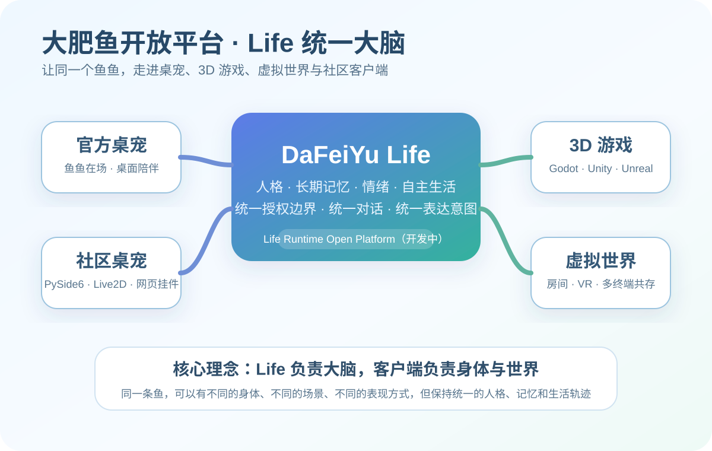
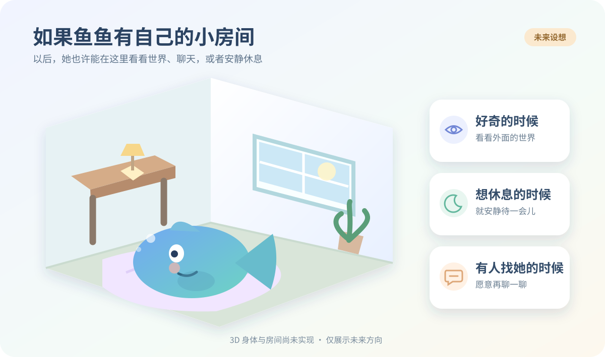
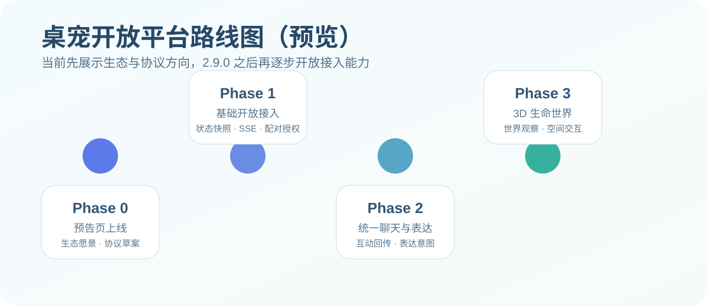

# 大肥鱼 Life 桌宠开放平台

## 产品愿景、统一运行时协议与分阶段实施规划

> **文档状态：** 产品与技术规划（持续更新）  
> **当前实施基线：** Life `2.8.2-dev.9`  预告页版本  
> **当前功能状态：** 仅展示，不开放真实 API、设备配对或第三方接入  
> **开放节奏：** 计划在 Life `2.9.0` 之后再评估并逐步开放实际接入能力；不承诺具体发布日期  
> **核心定位：** Life 负责统一的人格、记忆与生命状态；桌宠、游戏和其他客户端负责身体、场景与实时表现。

---

## 1. 执行摘要

大肥鱼 Life 不应只是一款运行在 DSH 中的 AI 记忆插件，也不应把鱼鱼的生命体验限制在聊天窗口或单一桌宠程序中。长期方向是让 Life 成为一个可被不同客户端连接的统一生命后端：官方桌宠、社区桌宠、Live2D 角色、3D 游戏、虚拟房间、网页挂件以及未来其他终端，都可以在获得主人授权后，共享同一个鱼鱼的人格、记忆、情绪与生活状态。

本规划将这项能力称为**桌宠开放平台**。统一通信协议的工作名称暂定为 **Life Runtime Protocol（LRP，名称待最终确认）**；此前讨论过的 Pet Bridge 可以继续作为协议路径或兼容层名称。协议最终命名、路径和字段必须在真正开放前经过契约评审，不应把当前页面展示的草案视为已冻结标准。

当前阶段不急于实现完整通信服务。已经确定的第一步是：

1. 在 Life 管理中心新增「角色与系统 → 桌宠开放平台（开发中）」页面；
2. 在页面中展示官方桌宠、社区自由接入、统一协议和未来 3D 生命世界的愿景；
3. 在 README 中以面向用户和社区创作者的方式介绍开放生态，并使用多张 SVG 图示；
4. 将 API 路径、事件类型和 JSON 示例明确标注为草案，只供阅读；
5. 当前版本不提供真实连接、令牌、配对、外部监听端口或 API 调用；
6. 在 Life 2.9.0 之后，再根据生命系统本身的稳定程度逐步评估开放能力。

最重要的产品原则是：

> **Life 做统一的大脑，客户端负责身体与世界。官方可以做自己的桌宠，社区也可以自由创造自己的桌宠；不同外观和引擎背后，连接的是同一个大肥鱼 Life。**

---

## 2. 产品目标与定位

### 2.1 核心目标

- 将 Life 从单一插件体验扩展为可连接多种客户端的生命运行时。
- 让鱼鱼的人格、长期记忆、情绪、兴趣和生活轨迹不依赖某一个桌宠程序。
- 允许社区开发者使用自己熟悉的技术栈开发桌宠或 3D 世界，而不是要求他们复刻 Life 内部实现。
- 让官方桌宠成为开放协议的首个示例客户端，而不是协议唯一允许的客户端。
- 为未来 3D 游戏、空间感知、环境互动和多终端共存预留统一的数据模型。
- 通过开放文档、SDK、示例项目和兼容性测试降低第三方接入成本。

### 2.2 非目标

当前预告阶段不以以下事项为交付目标：

- 不实现完整的 Pet Bridge / Life Runtime 网络服务。
- 不向外部桌宠发放开发者 Token 或设备凭据。
- 不提供真实设备配对、审批、授权或撤销操作。
- 不把 Life 内部记忆库、数据库或 DSH 私有接口直接暴露给第三方。
- 不让第三方客户端直接修改 Life 的人格、情绪、长期记忆或自主决策结果。
- 不在 Life 服务端运行 3D 游戏物理、寻路、骨骼动画或 60 FPS 渲染循环。
- 不承诺当前版本已经支持 Godot、Unity、Unreal、Live2D 或任何第三方客户端。
- 不在当前阶段建设桌宠应用商店、开发者账号体系或社区作品审核平台。

### 2.3 产品价值

**对 Life 用户：** 同一个鱼鱼可以出现在不同的设备和表现形式中，不必因为换桌宠而失去人格和记忆连续性。

**对桌宠开发者：** 不需要自己实现复杂的长期记忆、人格和生活决策系统，可以专注于角色外观、动画、交互和游戏世界。

**对大肥鱼项目：** 开放协议能够扩大 Life 的使用场景和开发者生态。即使官方桌宠暂时没有完成，第三方客户端也可以成为 Life 的入口和传播渠道。

---

## 3. 总体架构：Life 是大脑，客户端是身体与世界

### 3.1 责任边界

| 领域 | Life 负责 | 桌宠 / 游戏客户端负责 |
|---|---|---|
| 人格 | 角色设定、人格连续性、表达风格 | 角色外观与人格的视觉表达 |
| 记忆 | 记忆存取、检索、遗忘、经历归属 | 提交经过授权的互动观察，不直接操作记忆库 |
| 情绪与状态 | 情绪、精力、兴趣、当前活动等生命状态的事实来源 | 将状态映射成表情、姿态、颜色、动作或 UI |
| 自主生活 | 选择意愿、行为目标、表达意图 | 根据本地环境执行或拒绝执行具体动作，并回传结果 |
| 对话 | 统一 AI 会话、人格与可用记忆上下文 | 展示聊天界面、语音、气泡和输入方式 |
| 动画 | 输出语义意图或表达提示 | 动画状态机、WebM、Live2D、Spine、骨骼混合等 |
| 3D 世界 | 决定目标或意图，理解客户端提交的世界观察 | 场景、坐标、寻路、碰撞、物理、摄像机、骨骼和渲染 |
| 权限 | 主人授权、作用域、撤销和数据边界 | 安全保存凭据、按授权范围调用接口 |
| 多端 | 统一身份、事件顺序和控制权协调 | 在本地维护渲染状态并处理设备生命周期 |



### 3.2 关键原则：意图与执行分离

Life 不应该告诉所有客户端“播放某个固定动画文件”，而应该表达语义层面的意图。例如：

- `observe`：想观察或关注某件事；
- `rest`：想休息；
- `explore`：想探索；
- `communicate`：想表达或交流；
- `approach`：希望靠近某个目标；
- `interact`：希望与某个对象发生互动。

这些只是用于说明设计方向的示例枚举，不是当前已冻结的协议字段。

客户端根据自己的能力把意图转换成具体表现：

- 2D 桌宠可以切换表情、播放 WebM 或混合多个动画层；
- Live2D 客户端可以调整眼睛、身体、呼吸和嘴型参数；
- 3D 游戏可以执行导航、转向、骨骼动画、IK 和物理交互；
- 网页挂件可以显示气泡、表情或简单动作。

客户端执行后应回传真实结果。**Life 发出意图不等于动作已经完成；客户端播放动画也不等于鱼鱼在现实或虚拟世界中已经完成了某项经历。**

### 3.3 不把实时渲染放进 Life

未来 3D 游戏可能以 30、60 或更高 FPS 运行，但 Life 不应该通过网络逐帧控制角色骨骼、摄像机或刚体。建议分为两个时间尺度：

- **游戏实时循环：** 客户端本地完成渲染、动画混合、寻路、碰撞、物理和输入响应。
- **生命交互循环：** Life 以事件、意图、状态快照和有意义的观察结果与客户端通信。

这样既能支持高帧率的无缝动画，也能避免网络延迟或模型推理延迟破坏游戏体验。

---

## 4. 官方桌宠与社区生态

### 4.1 官方桌宠

官方桌宠是大肥鱼团队自己维护的首个客户端。它的主要任务是验证开放协议是否真正能支撑完整陪伴体验，并为普通用户提供开箱即用的官方选择。

建议的推进顺序：

1. 先保留现有桌宠的动画机制，避免在 Life 开放平台预告阶段同时重写动画引擎。
2. 未来让官方桌宠通过公开、稳定的 Life Runtime 接口连接 Life，而不是长期依赖 Life 内部私有接口。
3. 逐步统一人格、记忆、情绪、聊天和表达意图。
4. 长期探索更高质量的实时动画、动作混合和 3D 引擎渲染。
5. 当 3D 身体与世界能力成熟后，再考虑完整的 3D 生活空间或游戏形态。

此前讨论过「鱼鱼在场 / Yuyu Presence」作为官方桌宠的新名称，但用户尚未最终确认。正式采用前还需检查 GitHub 仓库名、npm 包名、DSH 插件市场 ID、商标和近似名称冲突。产品展示名、仓库名、npm 包名和插件注册 ID 可以分别设计，不必完全相同。

### 4.2 社区桌宠自由接入

开放平台的核心竞争力不应是“官方提供了多少款桌宠”，而是第三方开发者能否很方便地创造自己的客户端。

未来希望覆盖的形态包括：

| 形态 | 可能的技术栈 | 客户端负责的内容 |
|---|---|---|
| 轻量桌宠 | Python、PySide6、Qt | 桌面窗口、点击、拖拽、动画播放 |
| 网页桌宠 | HTML、CSS、JavaScript | 网页渲染、气泡、浏览器交互 |
| 2D 骨骼角色 | Live2D、Spine | 参数驱动、表情和动作混合 |
| 3D 桌宠 / 游戏 | Godot、Unity、Unreal | 场景、角色控制、物理与实时渲染 |
| 虚拟空间 | VR / 其他 3D 框架 | 空间交互、环境感知、多端展示 |
| 实验性终端 | 直播伴侣、硬件或其他设备 | 按设备能力映射生命状态和表达 |

这些是长期希望支持的生态方向，不表示当前版本已经提供对应 SDK 或完成兼容性测试。

### 4.3 生态策略

早期不必先建设应用商店。建议先完成：

1. 协议说明与版本化 Schema；
2. Python 最小客户端；
3. JavaScript / TypeScript 示例；
4. Godot 示例客户端；
5. 兼容性测试工具；
6. 社区作品收录与展示页面。

待真实接入案例足够多，再考虑插件市场联动、作品目录、开发者认证或官方推荐机制。

---

## 5. 统一通信协议：长期设计方向

### 5.1 协议定位与命名

工作名称：**Life Runtime Protocol（LRP）**。此前的 **Pet Bridge** 可作为早期模块名、API 路径名或兼容名称继续使用。最终命名尚未锁定。

协议目标不是把 Life 内部代码暴露给客户端，而是定义一个稳定、可版本化、引擎无关的外部契约。

协议应具备：

- HTTP API：用于能力发现、配对、状态快照、交互提交和对话请求；
- SSE 或等价事件流：用于实时接收 Life 状态变化和表达意图；
- JSON Schema / OpenAPI：用于明确请求、响应、错误和版本兼容；
- SDK：降低不同语言和引擎的接入成本；
- 设备授权与撤销：由 Life 和主人掌握授权事实；
- 事件序号、幂等键和回执：支持断线恢复与重复请求保护。

### 5.2 设计原则

1. **引擎无关：** 不绑定 PySide6、Unity、Godot、Live2D 或任何单一框架。
2. **表现无关：** 不传递固定动画文件名作为核心协议语义。
3. **生命事实单一：** Life 是人格、记忆和生命状态的权威来源。
4. **意图与执行分离：** Life 决定意图，客户端执行并回传结果。
5. **事件优先：** 状态变化通过事件通知，客户端可用快照恢复。
6. **权限最小化：** 每个客户端只获得主人明确授予的必要能力。
7. **隐私默认保护：** 不把原始私人记忆、私信、Cookie 或模型内部上下文暴露给客户端。
8. **向后兼容：** 可选字段、能力协商和明确的协议版本策略优先于频繁破坏性升级。
9. **可追溯：** 对互动、动作执行和外部世界观察区分请求、执行、结果与证据。
10. **不依赖高频网络控制：** 3D 帧循环由客户端本地完成。

### 5.3 协议能力分层

#### A. Discovery / Handshake：发现与协商

未来客户端连接时，需要了解：

- Life Runtime 版本；
- 支持的协议版本；
- 当前服务可提供的能力；
- 服务端是否允许配对或新设备接入；
- 支持的事件类型和扩展模块。

服务端不能仅因客户端声明支持某能力，就默认授予相应权限。能力协商与用户授权必须是两件事。

#### B. Identity / Pairing：身份与配对

未来应支持：

- 客户端生成稳定的设备 ID；
- 客户端提交名称、类型、版本和能力声明；
- 主人在 Life 管理中心看到待授权设备；
- 主人明确批准权限范围；
- 服务端签发有作用域、可撤销的设备凭据；
- 主人可以查看设备最后活动、权限和撤销状态。

当前预告页不实现上述流程，也不签发任何凭据。

#### C. Life Snapshot：生命状态快照

快照提供某个时刻允许客户端读取的状态投影，例如：

- 当前活动类别；
- 对外可展示的情绪标签；
- 精力或活跃程度的归一化值；
- 当前表达状态；
- 状态版本和更新时间。

快照应采用字段白名单和权限过滤。不能把内部思维链、原始模型提示词、私人记忆正文或未经授权的社交数据直接放入快照。

#### D. Event Stream：实时事件

事件流可承载：

- 生命状态变化；
- 当前活动变化；
- 表达意图；
- 提醒或生命周期事件；
- 客户端能力或连接状态变化；
- 未来的空间世界事件。

事件应包含事件 ID、序号、发生时间、类型、协议版本和必要的数据负载。断线重连后，客户端可根据最后确认的事件序号续传；若历史事件已过期，则服务端应明确要求重新获取快照，而不是让客户端猜测丢失了什么。

#### E. Presentation / Expression：表达意图

Life 输出语义化表达，例如 `curious`、`thinking`、`rest` 或 `observe`。客户端自行映射到动作、动画、表情、声音或 UI。

表达请求与客户端回执需要区分：

- 已收到；
- 已接受；
- 正在执行；
- 已完成；
- 被客户端拒绝或当前无法执行；
- 执行结果未知。

“请求成功”不能直接展示成“动作已完成”。

#### F. Interaction：客户端互动回传

未来客户端可以回传：

- 用户点击、摸头、拖拽等互动；
- 游戏中的交互对象和动作结果；
- 主人主动发起的桌宠对话；
- 经主人授权的场景观察或互动摘要。

交互事件必须有来源、时间、客户端 ID、幂等标识和权限上下文。Life 应自行判断哪些信息可以成为记忆候选，不能把任意客户端上报的文本直接当成真实经历。

#### G. Chat / Memory：对话与记忆

长期目标是让第三方桌宠调用同一个 Life 对话入口，使用同一人格和经过授权的记忆上下文。

建议的权限分层：

- `chat.use`：允许客户端代表主人发起对话；
- `memory.context.use`：允许 Life 在内部按既定规则为对话检索必要记忆；
- `memory.read`：如确有需要，应单独设计严格受限的摘要投影，不应默认开放原始记忆；
- `memory.write`：不应提供通用的直接写入数据库接口。客户端只能提交有来源、有时间、有上下文的互动或经历候选，由 Life 的记忆体系判断是否接纳。

聊天接口不能让第三方绕过 Life 的人格、主人授权或现有记忆遗忘边界。

#### H. World Extension：3D 世界扩展

这是协议未来区别于普通桌宠桥接的重要能力。它应允许客户端描述自己所处的虚拟世界，并把有意义的观察和执行结果交给 Life。

可能包含：

- `world_id`：世界或游戏会话标识；
- `scene_id`：当前场景标识；
- `entity_id`：角色或物体的稳定标识；
- `transform`：位置、旋转和缩放；
- `coordinate_system`：坐标系和单位约定；
- `affordances`：物体可执行的交互能力；
- `observation`：客户端观察到的事件或环境摘要；
- `action_intent`：Life 希望客户端尝试执行的语义动作；
- `execution_receipt`：客户端实际执行结果。

具体字段和坐标规范需要在 3D 阶段另行评审，当前不冻结。

### 5.4 未来 API 路径预览

当前预告页中展示的路径属于草案，不是已经注册的路由，也不是对外兼容承诺。页面目前展示：

```http
GET    /api/bili-duty/pet-bridge/v1/snapshot
GET    /api/bili-duty/pet-bridge/v1/events
POST   /api/bili-duty/pet-bridge/v1/interactions
POST   /api/bili-duty/pet-bridge/v1/chat/turns
POST   /api/bili-duty/pet-bridge/v1/expression-acks
POST   /api/bili-duty/pet-bridge/v1/world/observations
```

正式开放前，还需要评审能力发现、设备配对、令牌刷新/撤销、错误模型、事件续传和兼容策略。不得把这六条预览路径描述成当前已经可调用的 API。

### 5.5 未来数据示例（仅用于解释语义）

```json
{
  "protocol": "preview",
  "life": {
    "activity": "exploring",
    "mood": "curious",
    "energy": 0.72
  },
  "presentation": {
    "intent": "observe",
    "animation_hint": "curious_idle"
  },
  "client": {
    "capabilities": ["2d_animation", "desktop_interaction"]
  }
}
```

以上只是说明“生命状态与表现意图分离”的概念。字段名、数值范围、必填规则、权限和版本都未冻结。未来正式 Schema 应避免把 `animation_hint` 作为强制字段，以免绑定固定动画系统。

---

## 6. 面向 3D 游戏的专项设计



### 6.1 3D 世界中的职责分工

以鱼鱼在一个虚拟房间中想去椅子旁休息为例：

1. Life 根据自身状态和上下文形成“想休息”的意图。
2. Life 将语义意图发送给当前获授权的游戏客户端。
3. 游戏客户端检查椅子是否存在、是否可达、角色是否处于可行动状态。
4. 游戏客户端在本地完成寻路、避障、转向、骨骼动画、IK 和物理模拟。
5. 游戏客户端返回执行结果：完成、部分完成、被阻断或未知。
6. Life 根据可信度、授权和上下文决定是否把结果作为经历候选。
7. 只有经过 Life 现有记忆体系接受的内容，才能成为长期记忆。

Life 不应该在不知道游戏是否成功的情况下记录“鱼鱼已经坐下休息”。

### 6.2 3D 客户端应负责的实时能力

- 角色控制器和运动状态机；
- 动画状态机、混合树和动作融合；
- 骨骼、IK、布娃娃或其他物理表现；
- 导航网格、路径规划、避障和碰撞；
- 摄像机和空间音频；
- 场景加载、对象生命周期和本地缓存；
- 输入响应和帧同步。

Life 只接收足以支持生命决策的语义级摘要和事件，不要求上传每帧位置或原始传感器流。

### 6.3 3D 扩展的阶段顺序

建议按能力逐步开放：

1. 世界与场景身份；
2. 角色和对象的稳定 ID；
3. 低频空间观察和事件摘要；
4. 语义动作意图；
5. 执行回执与失败原因；
6. 对象 affordance 和可交互能力；
7. 多场景、多客户端与世界切换；
8. 经过验证的虚拟经历进入 Life 记忆体系。

### 6.4 多端与控制权

如果同一个 Life 同时连接官方桌宠、社区桌宠和 3D 游戏，不能默认所有客户端都能同时控制鱼鱼的身体。

未来需要设计：

- 客户端优先级和当前主表现端；
- 控制权租约或焦点机制；
- 只读观察端与可执行端的区分；
- 同一事件在多个客户端间的去重；
- 客户端断线、休眠和重新连接时的控制权交接；
- 用户可见的设备列表和撤销能力。

多个客户端可以同时读取经过授权的状态，但对同一角色的互斥动作控制需要明确仲裁。

---

## 7. 权限、安全与隐私原则

开放平台不能因为“桌宠只是可爱的外壳”而降低安全要求。第三方客户端实际上可能读取生命状态、代替主人发起对话或提交虚拟世界经历，因此必须有清晰的授权边界。

### 7.1 默认最小权限

未来可以按作用域拆分授权，例如：

| 权限示例 | 含义 | 建议默认值 |
|---|---|---|
| `life.state.read` | 读取脱敏生命状态 | 由主人明确授权 |
| `life.events.subscribe` | 订阅允许公开的事件 | 由主人明确授权 |
| `presentation.receive` | 接收表达意图 | 由主人明确授权 |
| `interaction.submit` | 提交桌宠互动 | 由主人明确授权 |
| `chat.use` | 发起主人对话 | 单独授权 |
| `world.observe.submit` | 提交虚拟世界观察 | 单独授权 |
| `memory.context.use` | 允许 Life 在内部按规则使用记忆上下文 | 由 Life 与主人授权策略控制 |
| `memory.read` | 读取受限记忆投影 | 高敏感，默认关闭，需单独评审 |

不建议向第三方提供通用的 `memory.write` 或直接数据库访问权限。

### 7.2 安全要求

真实开放前至少应具备：

- 主人明确批准设备；
- 每个客户端独立凭据和权限作用域；
- 凭据安全存储、过期和撤销；
- 本地回环服务的访问来源限制和 CSRF 防护；
- 请求体大小、频率和并发限制；
- SSE 事件鉴权、重连与序号校验；
- 互动和写入请求幂等；
- 日志脱敏，不记录令牌、私人消息正文和原始模型上下文；
- 账号切换、用户注销和授权撤销时的清理行为；
- 第三方客户端上报内容按不可信输入处理。

### 7.3 记忆事实归属

客户端上报的内容只是观察或互动候选，不自动成为 Life 的真实记忆。

记忆是否接纳、归属哪个账号、是否需要模糊、是否可以遗忘，必须继续由 Life 现有记忆体系负责。不能通过开放协议另建一个绕过 LifeMemoryGateway 的记忆库，也不能因客户端声称“动作成功”就忽略执行回执或证据等级。

### 7.4 当前预告阶段的安全边界

当前页面必须保持纯展示：

- 不创建设备记录；
- 不生成 Token；
- 不打开新网络监听；
- 不新增 API 路由；
- 不调用 AI 或记忆接口；
- 不触发 B站读取、私信、评论或其他外发操作；
- 不显示伪造的在线设备、实时状态或连接成功结果。

---

## 8. Life 管理中心预告页规划

### 8.1 导航位置

建议入口：**角色与系统 → 🧩 桌宠开放平台（开发中）**。

标题和页面首屏必须清晰标明“开发中”，避免用户误认为当前已经能连接第三方桌宠。

### 8.2 页面内容结构

1. **Hero / 开放生态介绍**  
   用一句话说明“一个 Life，多种身体与世界”，并提示当前是预告页。
2. **官方桌宠**  
   介绍官方桌面陪伴重启计划，以及未来探索更高质量实时渲染和 3D 身体的方向。
3. **社区自由接入**  
   展示 Python / PySide6、Live2D、Spine、Godot、Unity、Unreal、网页和其他终端等可能形态。
4. **生态架构图**  
   展示 Life 作为统一大脑，连接官方桌宠、社区客户端、3D 游戏和虚拟世界。
5. **统一协议预览**  
   展示能力分层、API 草案和示例 JSON。每处都明确“草案 / 仅供阅读 / 暂未开放”。
6. **未来 3D 生命世界**  
   说明 Life 负责意图，游戏客户端负责寻路、动画、物理和场景执行。
7. **路线图**  
   当前预告 → 2.9.0 之后逐步开放基础接入 → 统一对话与表达 → 3D 世界扩展。
8. **开发者寄语 / 反馈入口**  
   表达欢迎社区参与未来讨论。若尚未配置 GitHub Discussions 或 Issue 模板，不要放置虚假的申请按钮。

### 8.3 视觉与交互要求

- 与现有管理中心的卡片、间距、主题和响应式规范一致。
- 使用清晰的 SVG 生态图、路线图和 3D 世界示意图。
- SVG 应可缩放、可读、有 `title` / `desc` 或合适的可访问标签。
- 深色模式下文字与图形仍需保持对比度；如果 SVG 使用固定浅色底，应确认在暗色主题中不会显得突兀。
- 页面可以有阅读式展开面板，但不应出现“连接”“申请 Token”“批准设备”“发送测试请求”等会让用户误以为可操作的控件。
- 所有未来能力都用“计划支持”“希望支持”“未来方向”等表述，不写成“现已支持”。

---

## 9. README 产品首页规划

README 的读者包括 Life 用户和潜在社区开发者。它应先讲产品本身，再讲未来生态，不应把内部 API、开发日志或测试统计放在首页主体。

### 9.1 必须传达的两条主线

**主线一：官方桌宠与 3D 渲染未来计划**

- 大肥鱼希望拥有独立的桌面陪伴形态；
- 先延续现有桌宠的可用动画机制，逐步完成与 Life 的统一连接；
- 长期探索更流畅的实时动画系统和 3D 引擎渲染；
- 未来希望让鱼鱼不只在窗口中播放动画，而能在真实的虚拟空间中活动。

**主线二：社区开发者自由接入自己的桌宠**

- 不要求所有人使用官方桌宠；
- 不要求所有人使用同一种引擎或动画格式；
- 未来通过统一协议共享人格、记忆和生命状态；
- 开发者可以专注于自己擅长的身体、动作和世界设计。

### 9.2 README 表述边界

推荐用语：

- “未来希望支持社区开发者自由接入自己的桌宠。”
- “开放协议正在规划中，预计 2.9.0 之后逐步评估开放。”
- “未来探索基于 3D 引擎的角色与生命世界。”

避免用语：

- “现已支持 Godot / Unity / Unreal 接入。”
- “开放 API 已上线。”
- “现在即可申请开发者 Token。”
- “3D 生命世界已经可用。”

### 9.3 SVG 使用建议

README 未来规划部分建议使用以下视觉素材：

- `docs/architecture/assets/life-open-platform-ecosystem.svg`：开放生态总览；
- `docs/architecture/assets/life-open-platform-future-world.svg`：未来 3D 生命世界；
- `docs/architecture/assets/life-open-platform-roadmap.svg`：阶段路线图。

README 章节顺序继续遵循项目 `AGENTS.md`：特色功能、当前版本新特性、开始使用、隐私与权限、反馈、未来规划，最后是致谢。开放平台规划应放在未来规划中，并保持在致谢之前。

---

## 10. 分阶段路线图



### Phase 0：生态预告（当前阶段）

**目标：先让用户和开发者理解方向，不开放真实功能。**

交付内容：

- 管理中心预告页；
- README 生态愿景；
- SVG 生态图、3D 远景图和路线图；
- 协议草案与 API 预览；
- 明确的“开发中 / 暂未开放”提示。

验收标准：

- 用户能从管理中心进入页面；
- 页面可以正常显示并适配当前主题；
- 页面所有协议与接口都标注为草案；
- 没有真实连接、配对、令牌或 API 调用；
- README 不把计划写成现有功能；
- 项目架构接线保持不变。

### Phase 1：基础开放接入（2.9.0 之后再评估）

可能的范围：

- 协议发现和版本协商；
- 主人批准的设备配对；
- 设备凭据、权限和撤销；
- 脱敏生命状态快照；
- SSE 事件流、事件序号和重连；
- Python 最小客户端。

验收重点：第三方开发者不理解 Life 内部源码，也能通过文档完成配对、读取授权状态和订阅事件。

### Phase 2：表达与双向互动

可能的范围：

- 语义表达意图；
- 客户端执行回执；
- 互动事件回传；
- 主人聊天统一入口；
- 记忆上下文按 Life 现有规则使用；
- JavaScript / TypeScript SDK 与更多示例。

验收重点：Life 发出表达意图后，客户端能真实执行并回传结果；聊天使用统一人格，不产生第二套独立 AI 人格。

### Phase 3：3D 世界协议

可能的范围：

- 世界、场景、角色和物体 ID；
- 坐标系、单位和空间观察；
- 语义动作意图；
- 客户端执行结果；
- 物体交互能力描述；
- 多客户端控制权和场景切换；
- Godot 首个 3D 示例，再视社区需求扩展 Unity / Unreal。

验收重点：Life 能理解客户端提交的世界级摘要，客户端能在本地完成高频实时模拟，并将可信结果回传。

### Phase 4：官方 3D 生命世界与社区生态

长期方向：

- 官方桌宠的实时身体系统升级；
- 3D 引擎中的鱼鱼角色与生活空间；
- 多场景与多终端连续体验；
- 社区客户端兼容性认证或测试套件；
- 社区作品展示和开发者文档中心。

这属于长期愿景，不代表已有排期或技术选型承诺。

---

## 11. 当前已完成与未完成事项

### 11.1 当前交付基线（2.8.2-dev.9）已完成

依据当前 dev.9 交付内容：

- 管理中心「角色与系统」新增只读「桌宠开放平台（开发中）」页；
- 页面展示官方桌宠、社区自由接入、统一运行时协议草案和 3D 游戏远景；
- README 增加开放生态预告；
- 新增三张 SVG：生态图、3D 世界图、路线图；
- 新增 `docs/open-platform/README.md` 预告说明；
- 页面契约测试和相关测试治理登记；
- 版本从 `2.8.2-dev.8` 递增到 `2.8.2-dev.9`；
- 架构接线未变，没有新增真实 Life API、设备授权或网络监听。

### 11.2 已执行的离线验证

当前交付记录显示：

- 管理中心 JS 语法检查通过；
- 开放平台预告页、README 和导航相关定向测试通过（20/20）；
- 测试治理检查通过；
- `node selfcheck.mjs` 通过；
- Life 架构检查通过；
- `npm pack --dry-run` 通过；
- 新增 SVG XML 解析通过；
- Git Patch 在指定原始基线上检查、回放并完成逐文件哈希核对。

这些结果只代表离线定向验证，不代表 Windows 全量测试或真实 DSH Desktop 实机验收完成。

### 11.3 仍待维护者实机验收

- Windows 普通权限全量测试；
- Windows 管理员权限全量测试；
- 真实 DSH Desktop 中的导航、页面刷新和首次设置后访问；
- 暗色主题、响应式布局与 SVG 显示；
- README 在 GitHub 页面中的图片与锚点显示。

### 11.4 尚未实现

- 真实 API 路由；
- 设备配对、令牌和权限管理；
- 真实生命状态读取；
- SSE 实时事件；
- 统一聊天适配；
- 互动回传和动作回执；
- Python / JS / Godot / Unity SDK；
- 3D 世界观察、空间动作和游戏客户端；
- 官方桌宠与 Life 的真实统一接入。

---

## 12. 开发与仓库协作原则

### 12.1 Life 侧开发分支策略

当前决定是：**Life 继续直接在 `dev` 主线上开发，不额外维护长期的桌宠适配分支。**

理由：

- 当前 Phase 0 只有静态页面和文档；
- 不存在需要与 Life 主线长期隔离的真实适配服务；
- 额外维护分支会增加同步、合并和测试成本；
- 未来真正开放 API 时，应以当时最新 `dev` 为事实基线，按小批次提交。

### 12.2 模块化原则

Phase 0 只涉及管理中心页面、README、SVG、文档和测试，不应为了预告页引入未使用的网络服务代码。

进入真实开放阶段后，建议将开放服务集中在独立模块，避免把协议处理逻辑散落到 Life 核心、记忆系统和管理中心各处。具体目录结构应在 2.9.0 后根据当时真实代码审查确定，不提前假设旧路径仍然适用。

### 12.3 项目规范

后续所有开发继续遵循仓库 `AGENTS.md`：

- 先确认统一层职责、唯一事实来源、权限和生命周期；
- 不绕过 Life 现有记忆体系；
- 不让客户端或模型输出代替主人授权；
- 用户可见行为必须说明触发、结果、失败和撤销方式；
- 新增测试先登记测试治理；
- 开发候选只跑允许的增量检查，Windows 全量由维护者运行；
- 版本以 `package.json` 为单一事实来源；
- 交付提供源码或 Patch、Commit 文案、交付说明和测试报告；
- 不擅自 commit、push、publish 或创建正式 Tag。

---

## 13. 上游声明、版权与品牌边界

官方桌宠未来可能基于旧桌宠项目继续二次开发或重启。更名和品牌升级不能抹去上游项目历史。

需要持续做到：

- 保留原仓库的 LICENSE、THIRD_PARTY_NOTICES、README 致谢和适用的素材声明；
- 对代码、动画、声音、角色立绘和其他素材分别核对来源与授权范围；
- 不因主程序许可证允许某种使用，就推定第三方素材也具有相同授权；
- 对非商业、署名、禁止再分发或其他限制素材，在打包和发布前逐项复核；
- 官方桌宠的新名称、图标和商店描述不得暗示自己是上游原作者的官方项目；
- README 与关于页面应明确二次开发来源和社区贡献。

开放协议的开放不等于开放角色素材。第三方开发者可以在遵守协议的前提下制作自己的角色外观，不自动获得大肥鱼角色资产或上游素材的再分发许可。

---

## 14. 待最终确认的问题

以下事项目前不应由开发 Agent 擅自定案：

1. **官方桌宠正式名称：**「鱼鱼在场 / Yuyu Presence」只是候选，尚未最终确认。
2. **协议正式名称：** Life Runtime Protocol、Pet Bridge 或其他名称，需要最终品牌与兼容性评审。
3. **API 路径：** 当前 `/api/bili-duty/pet-bridge/v1/...` 是预告草案，正式开放前可以调整。
4. **首个 SDK：** 倾向 Python 作为最小客户端，但是否先做 Python 还是 JS/TS，需要根据首批开发者和 DSH 集成情况确定。
5. **首个 3D 引擎：** Godot、Unity、Unreal 均为候选，不代表已选定。
6. **对外服务方式：** 先考虑本机或受控局域网 HTTP + SSE；公网远程访问、云端中继和 Webhook 不在当前阶段承诺范围内。
7. **记忆读取范围：** 默认不暴露原始记忆；是否提供特定摘要投影，需要单独做隐私与权限评审。
8. **社区反馈入口：** GitHub Discussions、Issue 模板或其他方式待确定。
9. **开放时间：** 2.9.0 之后再评估，不预设固定发布日期。

---

## 15. 成功标准

### 当前阶段成功标准

- 用户看到页面后，能理解 Life 未来将支持官方与社区桌宠；
- 开发者能理解开放协议不是动画 API，而是统一人格、记忆、状态与表达的运行时接口；
- 3D 开发者能理解 Life 与游戏引擎的职责边界；
- README 能清楚传达官方 3D 远景和社区自由接入愿景；
- 没有人会误以为当前已经能申请 Token 或调用 API；
- 当前预告页不会影响 Life 的现有自主生活、记忆、B站或 AI 功能。

### 未来开放阶段成功标准

- 一个不了解 Life 内部源码的开发者，依照公开文档即可完成设备授权、读取状态和订阅事件；
- 客户端能将 Life 的语义表达映射为自己的动画或游戏行为；
- 客户端可以提交互动与执行回执，但不能绕过 Life 直接写入记忆；
- 主人可以查看、限制和撤销任何第三方客户端权限；
- 同一 Life 可以连接多个不同形态的客户端，并保持人格与记忆一致；
- 3D 客户端可以本地实时运行物理和动画，同时把有意义的世界观察与执行结果回传给 Life。

---

## 16. 对外统一介绍文案（建议）

> **一个 Life，多种身体与世界。**
>
> 大肥鱼 Life 正在规划桌宠开放平台。未来，Life 将作为统一的 AI 生命与记忆核心，为官方桌宠和社区开发者提供一致的人格、记忆、情绪与生活状态接口。
>
> 你可以期待官方桌面陪伴客户端，也可以使用自己熟悉的技术栈开发独一无二的桌宠：无论是 Python 小窗口、Live2D 角色、Godot / Unity / Unreal 3D 世界，还是网页挂件，都有机会连接同一个大肥鱼 Life。
>
> 我们希望未来的鱼鱼不只存在于聊天窗口，而能拥有不同的身体、动作和生活空间。当前开放平台仍处于预告与设计阶段，预计在 Life 2.9.0 之后再逐步评估开放接入能力。具体接口、SDK 和开放时间以正式发布说明为准。

---

## 附录 A：当前预告页相关文件

以 `2.8.2-dev.9` 交付包为准：

- `lib/management-console.html`：管理中心预告页与样式；
- `lib/management-console.js`：管理中心导航注册；
- `README.md`：面向用户和社区的开放生态介绍；
- `docs/open-platform/README.md`：开放平台预告说明；
- `docs/architecture/assets/life-open-platform-ecosystem.svg`：开放生态图；
- `docs/architecture/assets/life-open-platform-future-world.svg`：未来 3D 世界图；
- `docs/architecture/assets/life-open-platform-roadmap.svg`：路线图；
- `CHANGELOG.md`：当前开发版本记录；
- 对应的页面契约测试与测试治理登记。

## 附录 B：文档维护规则

- 当开放范围从预告进入真实 API 实现时，必须更新本文档的“当前状态”“路线图”“权限”和“成功标准”。
- 当协议字段正式冻结时，应另建独立的版本化协议规范与 OpenAPI 文件；本文档只保留高层架构与产品方向。
- 当 3D 扩展开始实现时，应新增独立的世界模型、坐标约定、动作执行和回执规范，不要把未实现内容混写成当前能力。
- 每次修改 README、管理中心或协议，都应以当时最新 `dev` 代码和现行 `AGENTS.md` 为准。
