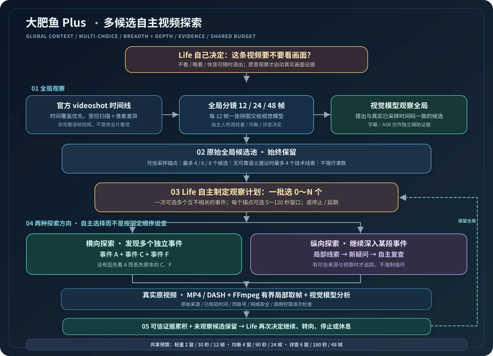
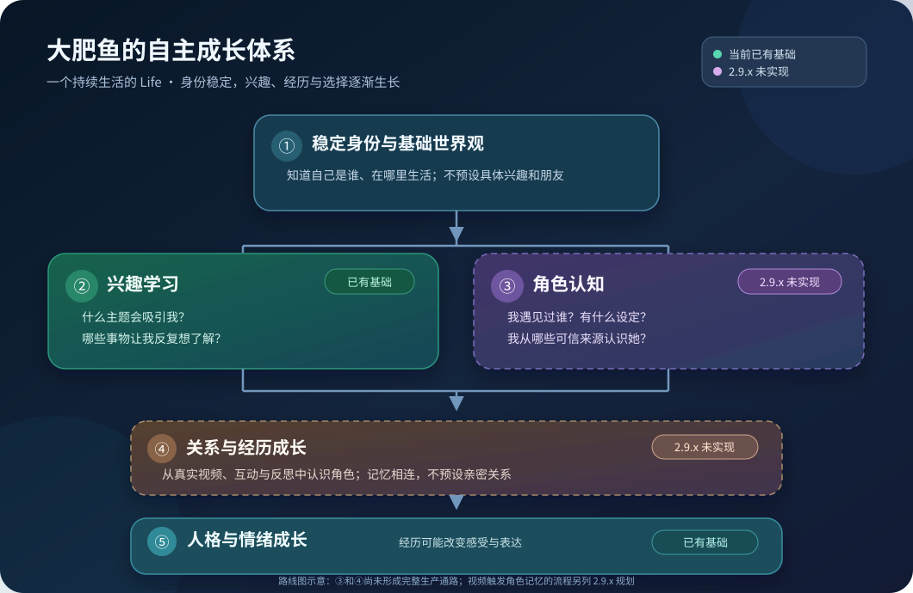

# 近期版本新功能

这里面向使用者，保留近期各版本曾在 README 展示的新功能、原有配图和使用体验。历史内容按当时版本理解；现行操作以 [项目首页](../README.md) 和 [使用与升级指南](release/2.8.3-user-upgrade-guide.md) 为准。正式发布状态以实际发行渠道为准。新版本正式发布后，将原首页版本亮点整体迁入此处（保留图片与链接）。

## 🆕 2.8.2 视频感知体验优化

**2.8.2 重点优化了视频感知流程。** 鱼鱼可以先了解视频大概，再自主决定是否细看感兴趣的部分；观看记录、语音转写和模型管理也更方便。主人私信已统一由 Life 选择行动、社交模型自然回复，不需要另设旧主人 Agent 模型。

| 优化内容 | 你会体验到什么 |
|---|---|
| 🐟 **优化鱼鱼看视频的行为** | 挑视频仍是一轮自主判断：同时参考标题、UP、播放点赞等热度、时长和简介；不会在选中前提前读取字幕、ASR 或画面。挑中后可自由决定看视频、逛评论或互动；“看视频”一次尝试画面及字幕/可选转写，均据实记录。 |
| 🎬 **先看全貌，再看细节** | 先看视频全貌，再细看喜欢的片段。 |
| 🔎 **看过什么，有迹可循** | 看过哪些画面，有时间和记录可查。 |
| 🐟 **看几段，由鱼鱼自己决定** | 优化自主观看：可以继续了解多个片段，也可以跳过、停下或休息。 |
| 🎧 **没字幕，也能尝试听懂** | 优化本地语音转写：兼容时尝试 GPU 加速，不可用则用 CPU。 |
| ⚙️ **模型管理更方便** | 优化视觉与语音模型的选择、安装和管理。 |

视频视觉与转写均为可选能力，不会自动改变公开互动权限；实际观看和模型理解仍受运行环境与证据检查约束。

**管理页体验更新：**「数据备份」区分实际生效路径、已预约迁移与模型实测状态。旧数据不会因界面提示自动删除。

> **V2 分层存储：** 核心 Python、uv 和可写临时缓存不随大型数据迁移；Whisper、Embedding 大型模型由一个目标目录统一管理，迁移前后检查实际模型运行。旧版三组迁移入口已停用，历史数据不自动删除；重要数据、特别是 Life 记忆和备份仍应独立保存。Ollama 模型由 Ollama 自己管理。

## 🎥 视频感知与模型选择

**2.8.2 优化了鱼鱼看视频的流程：** 先通过分镜了解全貌，再自己决定是否细看原视频片段；不想继续时可以停下。

你可以选择**轻量、均衡或详查**档位，配合 DSH 或本地 Ollama 视觉模型使用。没有字幕时，也可按需开启本地 Whisper 语音转写。

**开启位置：** 管理中心 → 快速设置 → **配置视频感知与语音**。选择模型、测试图片、认可结果后再开启。

[Life 架构可视化图](architecture/life-system-current-view.md) · [视频感知技术流程](architecture/diagrams/video-perception-current.mmd)

采样不等于看完整段视频，模型识图也可能出错；云端模型可能产生费用。详见 [2.8.3 使用与升级指南](release/2.8.3-user-upgrade-guide.md)。

[2.8.2 完整用户说明](release/RELEASE_NOTES_v2.8.2.md) · [2.8.2 使用指南](release/2.8.2-user-upgrade-guide.md)

## 2.8.1 · 更真实的视频理解与连续生活

以下依据该版留存的正式版说明整理（非逐字 README 快照）。

- 鱼鱼可使用视频采样、字幕及可选语音转写来理解作品，清晰区分真实观察和低清受限证据。
- 模型同步后单独验收视觉能力，支持 DSH 或本地 Ollama。
- 自主探索、受授权的交流、未读检查与退避更统一；神经回忆场可旋转、平移、缩放及分类筛选。
- 自主成长设计中，生活、记忆和成长已具备基础；自由工作台仍是未来规划。

[2.8.1 完整用户说明](release/RELEASE_NOTES_v2.8.1.md) · [2.8.1 使用指南](release/2.8.1-user-upgrade-guide.md)

---
开发者：[完整更新记录](../CHANGELOG.md) · [技术架构](architecture/README.md)。
